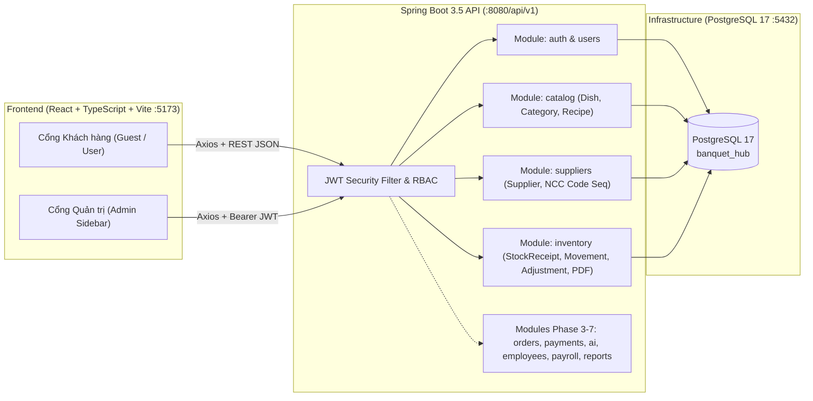

# Kiến trúc Hệ thống BanquetHub (Architecture Overview)

## 1. Phong cách kiến trúc: Modular Monolith

**BanquetHub** được thiết kế theo kiến trúc **Modular Monolith** đặt trong một **Monorepo** (`banquet-hub`):

- **Đơn giản hóa vận hành**: Không sử dụng Microservices hay Kubernetes phức tạp không cần thiết cho phạm vi 01 cơ sở kinh doanh và 01 kho nguyên liệu của MVP.
- **Ranh giới module rõ ràng**: Backend (`com.banquethub`) tách biệt phần lõi dùng chung (`common`) và các module nghiệp vụ độc lập (`modules.*`).
- **Đảm bảo tính toàn vẹn giao dịch (ACID)**: Toàn bộ các nghiệp vụ nhạy cảm (cấu hình công thức món, nhập kho, tính lại giá vốn di động, ghi sổ biến động kho, khóa tồn tạm) sử dụng cơ chế `@Transactional` trên PostgreSQL 17.

---

## 2. Cấu trúc Package Backend (`com.banquethub`)

- **`com.banquethub.common`**:
  - `config/`: `SecurityConfig` (Spring Security 6, Stateless JWT, CORS, JSON 401/403 handlers), `OpenApiConfig` (Swagger), `DemoDataInitializer`, `SystemHealthController`.
  - `security/`: `JwtTokenProvider` (HS256), `JwtAuthenticationFilter`, `CustomUserDetails`, `CustomUserDetailsService`.
  - `dto/`: `ApiResponse<T>`, `ApiErrorResponse`.
  - `exception/`: `GlobalExceptionHandler` (`@RestControllerAdvice`), `ResourceNotFoundException`, `BusinessValidationException`, `DuplicateResourceException`.
- **`com.banquethub.modules`**:
  - **`users` & `auth`**: Quản lý thực thể `User`, phân quyền RBAC (`ROLE_USER`, `ROLE_EMPLOYEE`, `ROLE_ADMIN`), đăng ký, đăng nhập (BCrypt + JWT), `/api/v1/auth/me`.
  - **`catalog`**: Quản lý `DishCategory`, `Dish`, `RecipeItem` (định lượng cho 01 phần món), thực thể `Ingredient` (kho).
  - **`suppliers` (Phase 2)**:
    - `entity/Supplier`: Đối tác cung cấp nguyên liệu.
    - `repository/SupplierRepository`: Tìm kiếm, đếm, tính tổng tiền đã nhập.
    - `service/SupplierService`: Nghiệp vụ quản lý NCC, chặn trùng số điện thoại, kích hoạt/tạm dừng.
    - `controller/AdminSupplierController`: `/api/v1/admin/suppliers/**`.
  - **`inventory` (Phase 2)**:
    - `entity/`: `StockReceipt`, `StockReceiptItem`, `StockMovement`, `StockAdjustment`.
    - `repository/`: `StockReceiptRepository`, `StockReceiptItemRepository`, `StockMovementRepository`, `StockAdjustmentRepository`.
    - `service/InventoryService`: Tra cứu tồn kho, cảnh báo tồn thấp, điều chỉnh kiểm kê, tra cứu sổ biến động, tổng quan dashboard kho.
    - `service/StockReceiptService`: Lập phiếu nhập (Nháp/Xác nhận), kiểm tra tính hợp lệ, tăng tồn kho đúng 1 lần, cập nhật giá vốn bình quân di động, ghi sổ `StockMovement`, ghi nhận thanh toán.
    - `service/PdfExportService`: Xuất phiếu nhập PDF A4 tiếng Việt có dấu chuẩn OpenPDF + Noto Sans Unicode SIL OFL.
    - `controller/`: `AdminInventoryController`, `AdminStockReceiptController`.
  - **`menus` (Phase 3)**:
    - `entity/`: `Menu`, `MenuItem`, `MenuStatus`.
    - `repository/`: `MenuRepository`, `MenuItemRepository`.
    - `service/MenuService`: Quản lý thực đơn mẫu, tính đơn giá bàn, quản trị CRUD thực đơn.
    - `controller/`: `MenuController` (Public), `AdminMenuController` (Admin).
  - **`reservations` (Phase 3)**:
    - `entity/`: `StockReservation`, `StockReservationItem`, `ReservationStatus`.
    - `repository/`: `StockReservationRepository`, `StockReservationItemRepository`.
    - `service/StockReservationService`: Khóa bi quan `PESSIMISTIC_WRITE`, kiểm tra tồn khả dụng (`physicalStock - activeReservedStock`), tạo lệnh giữ kho 15 phút, giải phóng kho.
    - `service/ReservationExpiryScheduler`: `@Scheduled(cron = "0 * * * * *")` tự động quét và hủy các đơn giữ kho quá 15 phút chưa thanh toán.
    - `controller/AdminReservationController`: Tra cứu lệnh giữ kho và báo cáo đối chiếu tồn khả dụng.
  - **`orders` (Phase 3)**:
    - `entity/`: `Order`, `OrderItem`, `OrderStatus`, `PaymentStatus`, `OrderStatusHistory`.
    - `repository/`: `OrderRepository` (hỗ trợ `JpaSpecificationExecutor`), `OrderItemRepository`, `OrderStatusHistoryRepository`.
    - `service/OrderPreviewService`: Tính thử realtime giá mỗi bàn, tổng tiền và nhu cầu nguyên liệu cho client.
    - `service/OrderService`: Tạo đơn đặt tiệc với Idempotency Key, chụp ảnh bất biến giá món (`dish_name_snapshot`, `unit_price_snapshot`), tích hợp giữ kho, hủy đơn và ghi audit log.
    - `controller/`: `OrderPreviewController`, `OrderController`, `AdminOrderController`, `EmployeeOrderController`.
  - **`employees` (Phase 6)**:
    - `entity/`: `Employee`, `EmployeeStatus`.
    - `repository/`: `EmployeeRepository` (hỗ trợ `JpaSpecificationExecutor`).
    - `service/EmployeeService`: Quản lý hồ sơ nhân viên, tự sinh mã NV `NV-XXXX`, liên kết tài khoản hệ thống `ROLE_EMPLOYEE`, bảo toàn lịch sử nhân sự `INACTIVE`.
    - `controller/`: `AdminEmployeeController`, `EmployeeSelfServiceController`.
  - **`attendance` (Phase 6)**:
    - `entity/`: `Attendance`, `AttendanceStatus` (`PRESENT`, `HALF_DAY`, `ABSENT`).
    - `repository/`: `AttendanceRepository`.
    - `service/AttendanceService`: Chấm công hàng ngày, chấm công hàng loạt, tính tổng công thực tế theo tháng, khóa chỉnh sửa khi kỳ lương đã `FINALIZED` hoặc `CLOSED`.
    - `controller/`: `AdminAttendanceController`.
  - **`payroll` (Phase 6)**:
    - `entity/`: `PayrollPeriod`, `PayrollAdjustment`, `Payroll`, `SalaryPayment`.
    - `repository/`: `PayrollPeriodRepository`, `PayrollAdjustmentRepository`, `PayrollRepository`, `SalaryPaymentRepository`.
    - `service/`: `PayrollCalculationService` (làm tròn HALF_UP đến từng đồng VND), `PayrollAdjustmentService`, `PayrollPeriodService`, `PayrollService`, `SalaryPaymentService` (khóa bi quan chống chi trùng).
    - `controller/`: `AdminPayrollPeriodController`, `AdminPayrollAdjustmentController`, `AdminPayrollController`, `AdminSalaryPaymentController`.
  - **Dự kiến mở rộng ở Phase 7**: `reports (Báo cáo kinh doanh, Phân tích chi phí & Lợi nhuận)`.

---

## 3. Kiến trúc Tính toán Giá Vốn Bình Quân Gia Quyền Di Động (Moving Weighted Average Cost)

Theo đặc tả `BR-07`, giá vốn bình quân di động được tính lại ngay tại thời điểm xác nhận nhập kho (`CONFIRMED`) theo công thức:

$$
\text{Cost}_{\text{mới}} = \frac{(\text{Stock}_{\text{cũ}} \times \text{Cost}_{\text{cũ}}) + (\text{Qty}_{\text{nhập}} \times \text{Price}_{\text{nhập}})}{\text{Stock}_{\text{cũ}} + \text{Qty}_{\text{nhập}}}
$$

- Tầng CSDL lưu `avg_unit_cost` kiểu `NUMERIC(18, 4)` để triệt tiêu hiện tượng sai số tích lũy (precision drift).
- Tầng Business logic tính toán hoàn toàn bằng `BigDecimal` với `RoundingMode.HALF_UP`.
- Ghi nhận `avg_cost_before` và `avg_cost_after` vào `stock_movements` cho từng lần nhập.

---

## 4. Kiến trúc Xuất File PDF Khổ A4 Tiếng Việt

- **Thư viện**: `com.github.librepdf:openpdf:2.0.3` (Giấy phép mã nguồn mở LGPL / MPL phù hợp mục đích thương mại).
- **Bộ font Unicode**: `NotoSans-Regular.ttf` và `NotoSans-Bold.ttf` đặt tại `backend/src/main/resources/fonts/` (Giấy phép SIL Open Font License 1.1).
- **Cơ chế nạp font**: Nạp từ `ClassPathResource` sang `BaseFont` với encoding `BaseFont.IDENTITY_H` và cờ `BaseFont.EMBEDDED = true`.
- **Bố cục chứng từ A4**:
  - Header thương hiệu nhà hàng (Tiêu chuẩn A4, lề 36pt).
  - Khối thông tin đối tác cung cấp, ngày nhập, mã phiếu tự sinh.
  - Bảng nguyên liệu chi tiết: STT, Mã, Tên, Đơn vị, Số lượng, Đơn giá, Thành tiền, Ghi chú.
  - Tổng tiền bằng số, số tiền đã trả, số tiền còn nợ.
  - Khối chữ ký xác nhận của Người lập phiếu và Người giao hàng.
- **Header truyền tải**: `Content-Type: application/pdf`, `Content-Disposition: attachment; filename="phieu-nhap-PN-xxxxxx.pdf"`.

## Phase 4
Module payments xác thực SePay và thực hiện settlement trong một transaction. Module notifications gửi email từ outbox sau commit. Xem [luồng thanh toán](PAYMENT_FLOW.md).
