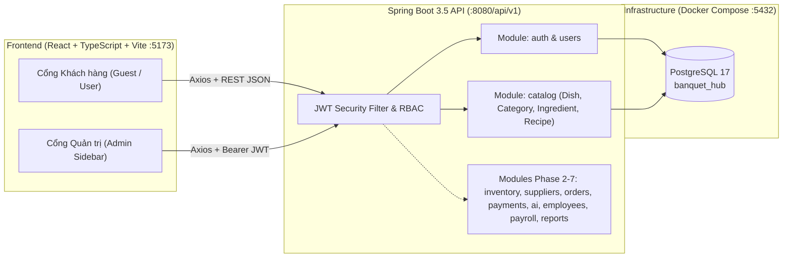

# Kiến trúc Hệ thống BanquetHub (Architecture Overview)

## 1. Phong cách kiến trúc: Modular Monolith

**BanquetHub** được thiết kế theo kiến trúc **Modular Monolith** đặt trong một **Monorepo** (`banquet-hub`):

- **Đơn giản hóa vận hành**: Không sử dụng Microservices hay Kubernetes phức tạp không cần thiết cho phạm vi 01 cơ sở kinh doanh và 01 kho nguyên liệu của MVP.
- **Ranh giới module rõ ràng**: Backend (`com.banquethub`) tách biệt phần lõi dùng chung (`common`) và các module nghiệp vụ độc lập (`modules.*`).
- **Đảm bảo tính toàn vẹn giao dịch (ACID)**: Toàn bộ các nghiệp vụ nhạy cảm (cấu hình công thức món, giữ tồn tạm 15 phút, xác thực VNPAY và trừ kho một lần) sử dụng chung cơ chế `@Transactional` trên PostgreSQL 17.

---

## 2. Cấu trúc Package Backend (`com.banquethub`)

- **`com.banquethub.common`**:
  - `config/`: `SecurityConfig` (Spring Security 6, Stateless JWT, CORS, JSON 401/403 handlers), `OpenApiConfig` (Swagger), `DemoDataInitializer` (khởi tạo tài khoản demo có kiểm soát), `SystemHealthController`.
  - `security/`: `JwtTokenProvider` (HS256), `JwtAuthenticationFilter`, `CustomUserDetails`, `CustomUserDetailsService`.
  - `dto/`: `ApiResponse<T>`, `ApiErrorResponse`.
  - `exception/`: `GlobalExceptionHandler` (`@RestControllerAdvice`), `ResourceNotFoundException`, `BusinessValidationException`, `DuplicateResourceException`.
- **`com.banquethub.modules`**:
  - **Đã triển khai ở Phase 1**:
    - `users`: Quản lý thực thể `User` và phân quyền `Role` (`ROLE_USER`, `ROLE_EMPLOYEE`, `ROLE_ADMIN`).
    - `auth`: Đăng ký, đăng nhập (BCrypt + JWT) và truy vấn hồ sơ hiện tại (`/api/v1/auth/me`).
    - `catalog`: Quản lý `DishCategory`, `Ingredient`, `Dish`, `RecipeItem` (định lượng nguyên liệu cho 01 phần món).
  - **Dự kiến mở rộng ở Phase 2–7**:
    - `inventory`, `suppliers`, `orders`, `payments`, `ai`, `notifications`, `employees`, `payroll`, `reports`.

---

## 3. Cấu trúc Frontend (`frontend/src`)

- `app/`: Khởi tạo `AuthProvider`, `ToastProvider` và `App`.
- `routes/`: `AppRouter` và `ProtectedRoute` kiểm tra quyền truy cập theo `Role`.
- `layouts/`: `PublicLayout` (khách vãng lai / khách hàng) và `AdminLayout` (giao diện quản trị có Sidebar).
- `pages/`: Các màn hình chạy thực tế (`HomePage`, `CatalogPage`, `DishDetailPage`, `LoginPage`, `RegisterPage`, `AdminCatalogPage`).
- `features/admin/`: Các modal nghiệp vụ chuyên biệt (`DishFormModal`, `RecipeConfigModal`, `IngredientFormModal`).
- `services/`: Kết nối Axios (`apiClient.ts`) thông qua biến môi trường `VITE_API_BASE_URL`, tách biệt `authService` và `catalogService`.
- `hooks/`: `useAuth`, `useToast`, `useFormatters` (chuẩn hóa tiền tệ `VND` và múi giờ `Asia/Ho_Chi_Minh`).

---

## 4. Các quyết định kỹ thuật quan trọng (ADR)

1. **Quản lý Schema bằng Flyway (`ddl-auto=validate`)**:
   - Toàn bộ bảng, khóa ngoại và ràng buộc `CHECK` được quản lý qua các file SQL có phiên bản (`V1`, `V2`...). Hibernate chỉ kiểm tra sự tương thích (`validate`), tuyệt đối không tự động sửa cấu trúc bảng ngầm.
2. **Kiểu dữ liệu số chính xác (`BigDecimal` / `NUMERIC`)**:
   - Tuyệt đối không dùng `double` hoặc `float` cho giá tiền và định lượng nguyên liệu. Tiền tệ VND dùng `NUMERIC(15, 2)` và định lượng nguyên liệu dùng `NUMERIC(12, 3)`.
3. **Bảo mật đa lớp (Defense in Depth)**:
   - Route guard ở Frontend chỉ phục vụ trải nghiệm người dùng; mọi API `/api/v1/admin/**` đều được chặn độc lập ở tầng `SecurityFilterChain` và `@PreAuthorize("hasAuthority('ROLE_ADMIN')")` tại Backend.
