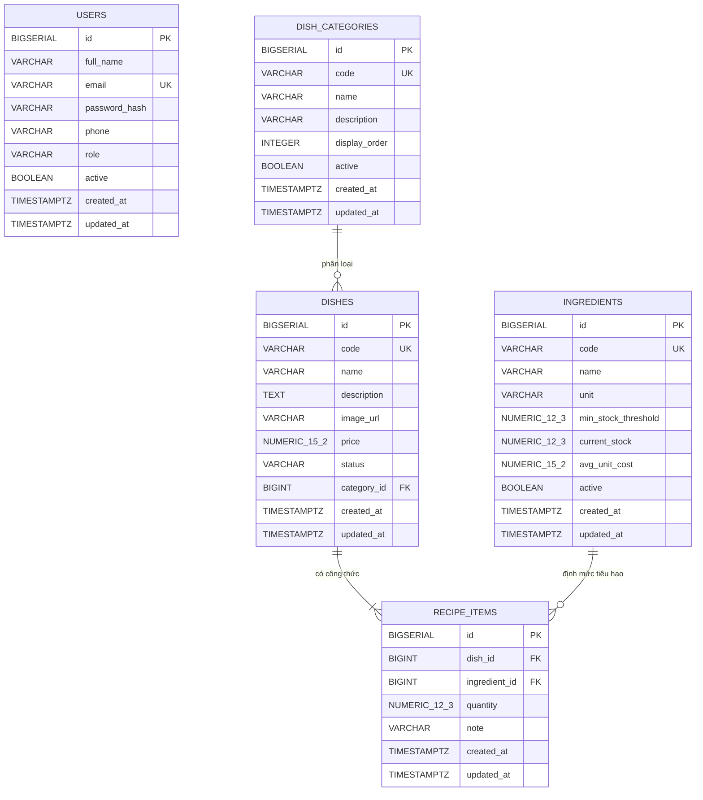

# Thiết kế Cơ sở dữ liệu BanquetHub – Phase 1

Hệ quản trị CSDL: **PostgreSQL 17** (`banquet_hub`)  
Quản lý Migration: **Flyway** (`backend/src/main/resources/db/migration/`)

---

## 1. Sơ đồ Thực thể – Liên kết (ERD Phase 1)

---

## 2. Chi tiết các bảng đã triển khai (`V1__init_phase1_schema.sql`)

### 2.1. Bảng `users`
Lưu trữ thông tin tài khoản của Khách hàng (`ROLE_USER`), Nhân viên (`ROLE_EMPLOYEE`) và Quản trị viên (`ROLE_ADMIN`).
- `email`: `UNIQUE NOT NULL`.
- `password_hash`: Chuỗi băm BCrypt.
- `role`: Ràng buộc `CHECK (role IN ('ROLE_USER', 'ROLE_EMPLOYEE', 'ROLE_ADMIN'))`.

### 2.2. Bảng `dish_categories`
Lưu trữ danh mục món ăn (`KHAI_VI`, `HAI_SAN`, `THIT_GIA_CAM`, `LAU_CANH`, `TRANG_MIENG`).
- `code`: `UNIQUE NOT NULL`.
- `display_order`: Thứ tự sắp xếp hiển thị trên menu.

### 2.3. Bảng `ingredients`
Lưu trữ danh mục nguyên liệu chuẩn hóa theo đơn vị gốc (`BR-03`: `kg`, `lít`, `cái`...).
- `min_stock_threshold`: `NUMERIC(12, 3) NOT NULL CHECK (min_stock_threshold >= 0)` — ngưỡng cảnh báo tồn kho thấp.
- `current_stock`: `NUMERIC(12, 3) NOT NULL CHECK (current_stock >= 0)` — tồn vật lý hiện tại.
- `avg_unit_cost`: `NUMERIC(15, 2) NOT NULL CHECK (avg_unit_cost >= 0)` — đơn giá vốn bình quân gia quyền.

### 2.4. Bảng `dishes`
Lưu trữ thông tin món ăn trong danh mục nhà hàng.
- `price`: `NUMERIC(15, 2) NOT NULL CHECK (price > 0)` — đơn giá bán cho 01 phần/đĩa (VND).
- `status`: `CHECK (status IN ('ACTIVE', 'HIDDEN'))` — cho phép ẩn món không còn kinh doanh mà vẫn bảo toàn dữ liệu lịch sử (`FR-CAT-02`).
- `category_id`: Khóa ngoại tham chiếu `dish_categories(id)`.

### 2.5. Bảng `recipe_items`
Lưu trữ định lượng nguyên liệu cần dùng cho **01 phần món** (`FR-REC-01`, `FR-REC-02`).
- `dish_id`: Tham chiếu `dishes(id) ON DELETE CASCADE`.
- `ingredient_id`: Tham chiếu `ingredients(id)`.
- `quantity`: `NUMERIC(12, 3) NOT NULL CHECK (quantity > 0)` — bắt buộc lớn hơn 0.
- Ràng buộc duy nhất `uq_recipe_dish_ingredient UNIQUE (dish_id, ingredient_id)` ngăn trùng lặp cùng một nguyên liệu trong một món ăn.

---

## 3. Dữ liệu khởi tạo mẫu (`V2__seed_demo_catalog.sql`)

- **5 danh mục món ăn**: Món Khai Vị & Gỏi, Hải Sản Cao Cấp, Thịt & Gia Cầm Đặc Sắc, Món Lẩu & Canh Tiềm, Tráng Miệng.
- **12 nguyên liệu chuẩn đơn vị gốc (`kg`)**: Tôm sú tươi loại 1, Thịt thăn bò Úc/Mỹ, Gà ta thả vườn, Cá chẽm tươi, Mực ống tươi, Sườn non heo, Nấm đông cô, Ngó sen tươi, Hạt sen tươi Huế, Rau củ tổng hợp, Bún tươi, Trái cây nhiệt đới.
- **10 món ăn nhà hàng tiệc Việt Nam (`DISH-001` đến `DISH-010`)** kèm 28 dòng định lượng công thức (`recipe_items`).
