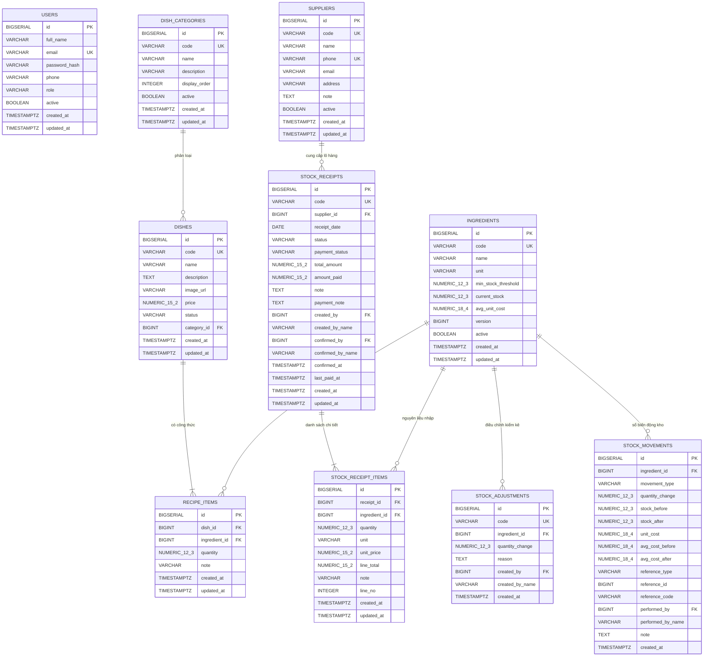

# Thiết kế Cơ sở dữ liệu BanquetHub

Hệ quản trị CSDL: **PostgreSQL 17** (`banquet_hub`)  
Quản lý Migration: **Flyway** (`backend/src/main/resources/db/migration/`)

---

## 1. Sơ đồ Thực thể – Liên kết Tổng thể (Phase 1 & Phase 2)

---

## 2. Chi tiết các bảng Phase 1 (`V1__init_phase1_schema.sql`)

### 2.1. Bảng `users`
Lưu trữ thông tin tài khoản của Khách hàng (`ROLE_USER`), Nhân viên (`ROLE_EMPLOYEE`) và Quản trị viên (`ROLE_ADMIN`).
- `email`: `UNIQUE NOT NULL`.
- `password_hash`: Chuỗi băm BCrypt an toàn.
- `role`: Ràng buộc `CHECK (role IN ('ROLE_USER', 'ROLE_EMPLOYEE', 'ROLE_ADMIN'))`.

### 2.2. Bảng `dish_categories`
Lưu trữ danh mục món ăn (`KHAI_VI`, `HAI_SAN`, `THIT_GIA_CAM`, `LAU_CANH`, `TRANG_MIENG`).
- `code`: `UNIQUE NOT NULL`.
- `display_order`: Thứ tự sắp xếp hiển thị trên thực đơn.

### 2.3. Bảng `ingredients`
Lưu trữ danh mục nguyên liệu chuẩn hóa theo đơn vị gốc (`BR-03`: `kg`, `lít`, `cái`...).
- `min_stock_threshold`: `NUMERIC(12, 3) NOT NULL CHECK (min_stock_threshold >= 0)` — ngưỡng cảnh báo tồn kho thấp.
- `current_stock`: `NUMERIC(12, 3) NOT NULL CHECK (current_stock >= 0)` — tồn vật lý hiện tại.
- `avg_unit_cost`: `NUMERIC(18, 4) NOT NULL CHECK (avg_unit_cost >= 0)` — đơn giá vốn bình quân gia quyền di động (được nâng độ chính xác ở Phase 2).
- `version`: `BIGINT NOT NULL DEFAULT 0` — Khóa lạc quan (Optimistic Locking) ngăn ngừa lost updates khi xác nhận phiếu nhập hoặc điều chỉnh kho đồng thời.

### 2.4. Bảng `dishes`
Lưu trữ thông tin món ăn trong danh mục nhà hàng.
- `price`: `NUMERIC(15, 2) NOT NULL CHECK (price > 0)` — đơn giá bán cho 01 phần/đĩa (VND).
- `status`: `CHECK (status IN ('ACTIVE', 'HIDDEN'))` — cho phép ẩn món không còn kinh doanh mà vẫn bảo toàn dữ liệu lịch sử (`FR-CAT-02`).

### 2.5. Bảng `recipe_items`
Lưu trữ định lượng thành phần nguyên liệu cấu thành món ăn theo quy chuẩn 01 phần.
- `quantity`: `NUMERIC(12, 3) NOT NULL CHECK (quantity > 0)`.
- Ràng buộc duy nhất `UNIQUE(dish_id, ingredient_id)`.

---

## 3. Chi tiết các bảng Phase 2 (`V3__phase2_inventory_suppliers.sql` & `V4__seed_phase2_suppliers.sql`)

### 3.1. Bảng `suppliers` (Nhà Cung Cấp)
Lưu trữ danh bạ các đối tác cung cấp thực phẩm, hải sản, gia vị.
- `code`: `VARCHAR(32) UNIQUE NOT NULL` (sinh tự động qua sequence `supplier_code_seq`, định dạng `NCC-000001`).
- `name`: `VARCHAR(150) NOT NULL`.
- `phone`: `VARCHAR(20) UNIQUE NOT NULL` — Chặn trùng số điện thoại ở cả tầng Database và Business Logic.
- `email`: `VARCHAR(150) NULL`.
- `address`: `VARCHAR(255) NULL`.
- `active`: `BOOLEAN NOT NULL DEFAULT true`.

### 3.2. Bảng `stock_receipts` (Phiếu Nhập Nguyên Liệu)
Lưu thông tin đầu phiếu nhập kho từ nhà cung cấp.
- `code`: `VARCHAR(32) UNIQUE NOT NULL` (sinh tự động qua sequence `stock_receipt_code_seq`, định dạng `PN-000001`).
- `supplier_id`: `BIGINT NOT NULL REFERENCES suppliers(id) ON DELETE RESTRICT`.
- `receipt_date`: `DATE NOT NULL` — Ngày lập chứng từ.
- `status`: `VARCHAR(30) NOT NULL CHECK (status IN ('DRAFT', 'CONFIRMED'))`.
  - `DRAFT`: Phiếu nháp, chưa tác động tồn kho, cho phép sửa/xóa.
  - `CONFIRMED`: Đã nhập kho, tồn kho đã tăng, giá vốn đã cập nhật; cấm sửa/xóa trực tiếp.
- `payment_status`: `VARCHAR(30) NOT NULL CHECK (payment_status IN ('UNPAID', 'PARTIALLY_PAID', 'PAID'))`.
- `total_amount`: `NUMERIC(15, 2) NOT NULL DEFAULT 0 CHECK (total_amount >= 0)` — Tổng tiền tự tính = SUM(line_total).
- `amount_paid`: `NUMERIC(15, 2) NOT NULL DEFAULT 0 CHECK (amount_paid >= 0 AND amount_paid <= total_amount)`.
- `created_by`, `confirmed_by`: Khóa ngoại tham chiếu `users(id)`.

### 3.3. Bảng `stock_receipt_items` (Chi Tiết Phiếu Nhập)
Mỗi dòng nguyên liệu trong phiếu nhập.
- `receipt_id`: `BIGINT NOT NULL REFERENCES stock_receipts(id) ON DELETE CASCADE`.
- `ingredient_id`: `BIGINT NOT NULL REFERENCES ingredients(id) ON DELETE RESTRICT`.
- `quantity`: `NUMERIC(12, 3) NOT NULL CHECK (quantity > 0)`.
- `unit`: `VARCHAR(30) NOT NULL` (khóa theo đơn vị gốc của kho).
- `unit_price`: `NUMERIC(15, 2) NOT NULL CHECK (unit_price >= 0)`.
- `line_total`: `NUMERIC(15, 2) NOT NULL CHECK (line_total >= 0)`.
- Ràng buộc duy nhất: `CONSTRAINT uq_receipt_item_ingredient UNIQUE(receipt_id, ingredient_id)` — Ngăn trùng lặp nguyên liệu trên 1 phiếu.

### 3.4. Bảng `stock_adjustments` (Chứng Từ Điều Chỉnh Tồn Kho)
Ghi nhận các biên bản kiểm kê điều chỉnh tồn kho thủ công của Admin.
- `code`: `VARCHAR(32) UNIQUE NOT NULL` (sinh tự động qua sequence `stock_adjustment_code_seq`, định dạng `DC-000001`).
- `ingredient_id`: `BIGINT NOT NULL REFERENCES ingredients(id) ON DELETE RESTRICT`.
- `quantity_change`: `NUMERIC(12, 3) NOT NULL CHECK (quantity_change != 0)` (+ để bù dư, - để trừ hao hụt).
- `reason`: `TEXT NOT NULL` — Bắt buộc phải có lý do kiểm kê/hư hỏng.

### 3.5. Bảng `stock_movements` (Sổ Biến Động Kho – Audit Log)
Ghi nhận đầy đủ lịch sử biến động kho cho từng nguyên liệu, bảo đảm tính minh bạch và truy vết kiểm toán.
- `movement_type`: `VARCHAR(30) NOT NULL CHECK (movement_type IN ('IMPORT', 'EXPORT', 'ADJUSTMENT'))`.
- `quantity_change`: `NUMERIC(12, 3) NOT NULL`.
- `stock_before`: `NUMERIC(12, 3) NOT NULL`.
- `stock_after`: `NUMERIC(12, 3) NOT NULL CHECK (stock_after >= 0)` — Ngăn chặn tồn âm ở cấp độ CSDL.
- `unit_cost`: `NUMERIC(18, 4) NOT NULL`.
- `avg_cost_before`, `avg_cost_after`: Ghi nhận sự thay đổi giá vốn bình quân di động trước và sau biến động.
- `reference_type`: `VARCHAR(30) NOT NULL CHECK (reference_type IN ('STOCK_RECEIPT', 'STOCK_ADJUSTMENT', 'ORDER', 'MANUAL'))`.
- `reference_id`: ID của chứng từ liên quan.
- `reference_code`: Mã chứng từ (PN-..., DC-...).
- Ràng buộc chống xác nhận cộng kho 2 lần:
  `CREATE UNIQUE INDEX uq_stock_movement_receipt_item ON stock_movements (reference_id, ingredient_id) WHERE reference_type = 'STOCK_RECEIPT';`
