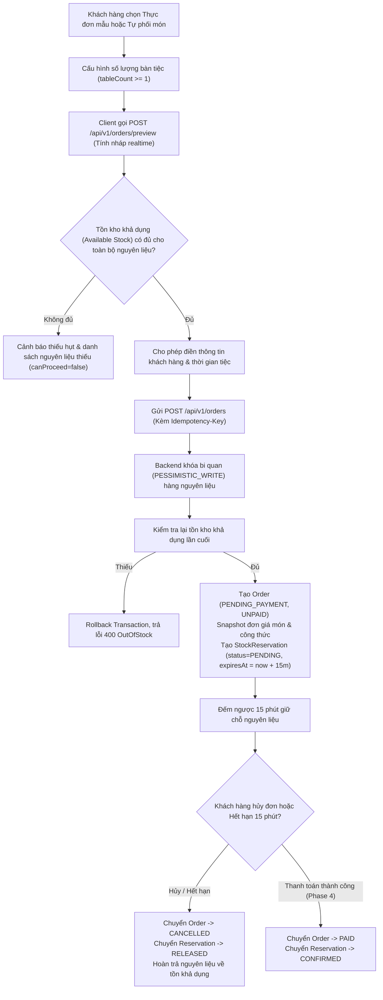

# QUY TRÌNH NGHIỆP VỤ ĐẶT TIỆC, THỰC ĐƠN & KHÓA GIỮ NGUYÊN LIỆU (PHASE 3)

Tài liệu này mô tả chi tiết kiến trúc nghiệp vụ, quy tắc tính toán tài chính, công thức xác định định lượng nguyên liệu, cơ chế khóa giữ tồn kho (Stock Reservation) và luồng xử lý đơn hàng tiệc trong hệ thống **BanquetHub** (tuân thủ đặc tả `SRS-PARTY-001`).

---

## 1. TỔNG QUAN LUỒNG NGHIỆP VỤ ĐẶT TIỆC

---

## 2. CÁC QUY TẮC NGHIỆP VỤ BẮT BUỘC (BUSINESS RULES)

### BR-01: Tính toán tài chính tập trung tại Backend
- Giá món ăn, giá thực đơn mỗi bàn và tổng giá trị đơn hàng được tính toán và kiểm chứng độc quyền tại Backend.
- Client tuyệt đối **không** được gửi các trường số tiền (như `price`, `totalAmount`) lên API tạo đơn. Nếu client gửi lên, Backend sẽ hoàn toàn bỏ qua và tự tính lại dựa trên giá hiện hành trong cơ sở dữ liệu.

### BR-02: Cấu hình thực đơn đồng nhất trên tất cả các bàn
- Trong phạm vi MVP (Phase 3), tất cả các bàn trong cùng một buổi tiệc chia sẻ chung một cấu hình thực đơn (món ăn và số lượng phần ăn/món/bàn).

### BR-03: Công thức tính tổng số phần ăn
$$\text{Total Portions}(\text{dish}_i) = \text{quantityPerTable}(\text{dish}_i) \times \text{tableCount}$$

### BR-04: Công thức tính nhu cầu nguyên liệu
Đối với mỗi nguyên liệu $j$ tham gia vào công thức của món $i$:
$$\text{Demand}(j) = \sum_{i} \left( \text{Total Portions}(\text{dish}_i) \times \text{RecipeQuantity}(i, j) \right)$$

### BR-05 & BR-06: Khóa giữ kho nguyên liệu (Stock Reservation)
- Tồn khả dụng (Available Stock) được tính như sau:
$$\text{Available Stock} = \text{Physical Stock} - \text{Active Reserved Stock}$$
Trong đó:
  - `Physical Stock`: Số lượng thực tế trong bảng `ingredients.current_stock`.
  - `Active Reserved Stock`: Tổng số lượng nguyên liệu đang nằm trong các lệnh giữ chỗ có `status = 'PENDING'` và `expires_at > NOW()`.
- Lệnh đặt tiệc chỉ được tạo thành công khi **tất cả** nguyên liệu đều thỏa mãn: $\text{Available Stock} \ge \text{Demand}$.
- **Lưu ý quan trọng**: Việc tạo Stock Reservation **KHÔNG** làm thay đổi `current_stock` vật lý và **KHÔNG** ghi nhận biến động kho `EXPORT` trong `stock_movements`. Việc trừ kho vật lý và ghi nhận xuất kho thực tế được kích hoạt ở **Phase 4** sau khi thanh toán thành công.

### BR-07 & BR-08: Vòng đời 15 phút giữ kho & Tự động hoàn kho
- Tại thời điểm tạo đơn (`POST /api/v1/orders`), hệ thống gán `payment_expires_at = NOW() + 15 phút`.
- Lệnh giữ chỗ `stock_reservations` được khởi tạo với trạng thái `PENDING`.
- Nếu quá 15 phút khách hàng chưa thanh toán hoặc khách hàng chủ động hủy đơn:
  - Trạng thái đơn đổi thành `CANCELLED`.
  - Trạng thái lệnh giữ chỗ đổi thành `RELEASED` kèm `released_at = NOW()`.
  - Toàn bộ định mức nguyên liệu được lập tức giải phóng về lại tồn khả dụng.
- Tiến trình nền `@Scheduled` (`ReservationExpiryScheduler`) quét mỗi phút để tự động hủy các đơn quá hạn.

### BR-10: Tính bất biến lịch sử (Historical Immutability & Snapshots)
- Bảng `order_items` lưu lại ảnh chụp (`dish_name_snapshot`, `unit_price_snapshot`) tại thời điểm đặt tiệc.
- Bảng `stock_reservation_items` lưu lại ảnh chụp định mức nguyên liệu tại thời điểm đặt.
- Mọi thay đổi về tên món ăn, tăng/giảm giá bán món trong tương lai đều **không** ảnh hưởng đến các đơn hàng đã tạo trước đó.

### BR-13: Chống trùng lặp đơn hàng (Idempotency Key)
- Client sinh mã UUID ngẫu nhiên (`crypto.randomUUID()`) và truyền qua HTTP Header `Idempotency-Key` (hoặc trường `idempotencyKey` trong body).
- Cột `orders.idempotency_key` được đánh chỉ mục `UNIQUE`. Nếu mạng chập chờn hoặc người dùng nhấn đúp, Backend phát hiện trùng lặp và trả về ngay đơn hàng đã tạo thay vì sinh đơn mới.

### BR-14: Khóa chống xung đột đồng thời (Pessimistic Concurrency Control)
- Khi thực hiện kiểm tra và giữ kho, Backend sử dụng khóa `PESSIMISTIC_WRITE` (tương đương `SELECT ... FOR UPDATE` trong PostgreSQL) trên các dòng nguyên liệu liên quan.
- Để ngăn ngừa Deadlock tuyệt đối, các `ingredientId` được sắp xếp theo thứ tự tăng dần (`sortedIds = requiredIngredients.keySet().stream().sorted().toList()`) trước khi tiến hành khóa dòng.

### BR-15 & BR-16: Điểm chạm tích hợp SePay (Phase 4)
- Trong Phase 3, chưa tích hợp cổng SePay. Mọi đơn tiệc mới tạo sẽ có `order_status = PENDING_PAYMENT` và `payment_status = UNPAID`.
- Giao diện có thông báo rõ ràng cho khách hàng về thời gian giữ chỗ 15 phút và lộ trình tích hợp SePay tại Phase 4.

---

## 3. DANH MỤC API PHASE 3

### 3.1. Public & Khách hàng
- `GET /api/v1/menus`: Danh sách thực đơn mẫu đang hoạt động (`ACTIVE`).
- `GET /api/v1/menus/{id}`: Chi tiết thực đơn mẫu kèm danh sách món và giá mỗi bàn.
- `GET /api/v1/menus/{id}/preview?tableCount=N`: Tính thử đơn giá và kiểm tra tồn kho cho thực đơn mẫu.
- `POST /api/v1/orders/preview`: Tính thử realtime đơn giá và kiểm tra tồn kho cho thực đơn tự chọn.
- `POST /api/v1/orders`: Tạo đơn đặt tiệc và kích hoạt giữ kho 15 phút.
- `GET /api/v1/orders/my-orders`: Danh sách đơn tiệc của tài khoản đăng nhập.
- `GET /api/v1/orders/{id}`: Chi tiết đơn hàng của tài khoản.
- `GET /api/v1/orders/by-code/{orderCode}`: Tra cứu đơn hàng theo mã đơn.
- `POST /api/v1/orders/{id}/cancel`: Khách hàng hủy đơn tiệc khi còn trong hạn thanh toán.

### 3.2. Quản trị viên (Admin)
- `GET /api/v1/admin/menus`: Quản lý danh sách thực đơn mẫu (phân trang, lọc theo tên/trạng thái).
- `POST /api/v1/admin/menus`: Thêm mới thực đơn mẫu.
- `PUT /api/v1/admin/menus/{id}`: Cập nhật thực đơn mẫu.
- `PATCH /api/v1/admin/menus/{id}/status`: Bật/tắt trạng thái áp dụng thực đơn.
- `GET /api/v1/admin/orders`: Quản lý toàn bộ đơn đặt tiệc (lọc theo trạng thái đơn, trạng thái thanh toán, khoảng thời gian).
- `GET /api/v1/admin/orders/{id}`: Chi tiết hợp đồng đơn tiệc, món ăn snapshot, lệnh giữ kho và audit log.
- `POST /api/v1/admin/orders/{id}/cancel`: Quản trị viên hủy đơn tiệc kèm lý do nghiệp vụ bắt buộc.
- `GET /api/v1/admin/inventory/reservations`: Quản lý danh sách lệnh giữ kho.
- `GET /api/v1/admin/inventory/reservations/availability`: Báo cáo đối chiếu tồn kho vật lý, tồn đang giữ và tồn khả dụng thực tế.

### 3.3. Nhân viên điều phối & Bếp (Employee)
- `GET /api/v1/employee/orders`: Lịch phục vụ tiệc sắp xếp theo ngày giờ tổ chức.
- `GET /api/v1/employee/orders/{id}`: Phiếu chế biến bếp, danh sách món ăn, số lượng phần cần nấu và tổng nguyên liệu xuất kho.

## Phase 4
Sau khi backend xác thực thanh toán và trừ kho, đơn chuyển PAID. Admin hoặc nhân viên cập nhật PREPARING rồi COMPLETED. Thanh toán cần đối soát được giữ riêng. Xem [luồng thanh toán](PAYMENT_FLOW.md).
