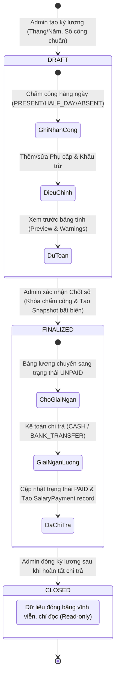
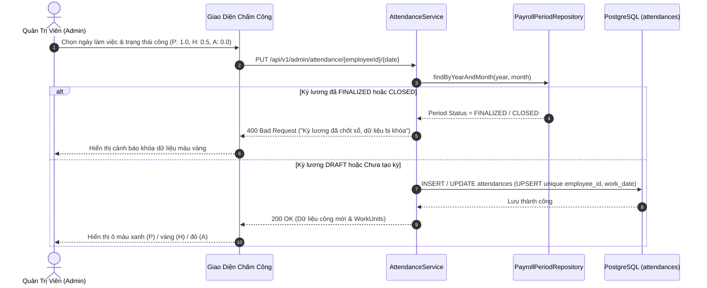
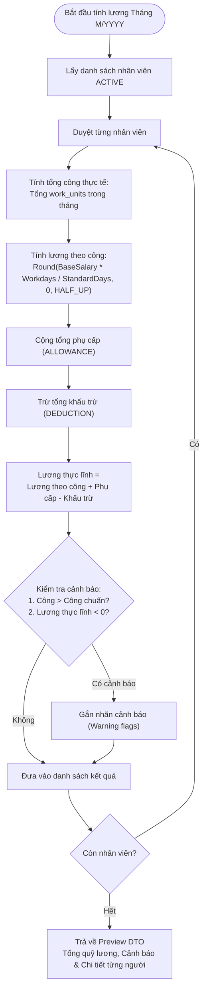
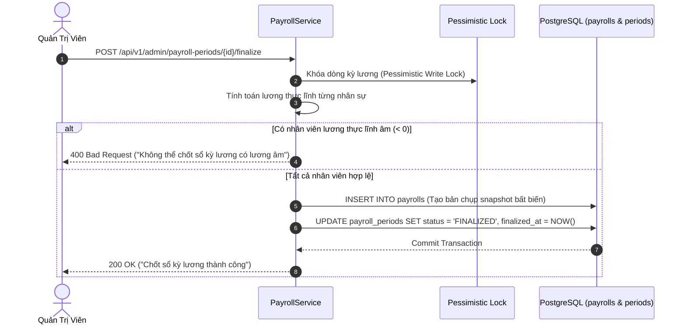
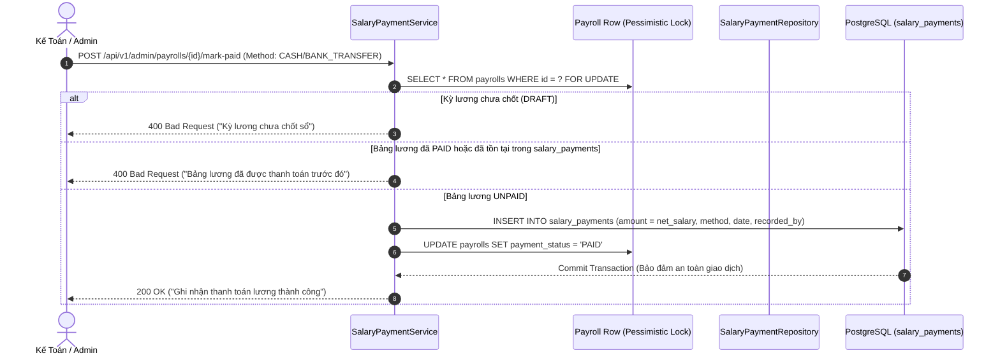
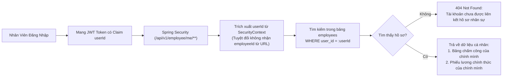

# BANQUETHUB - QUY TRÌNH CHẤM CÔNG & TÍNH LƯƠNG (WORKFLOWS)

Tài liệu trực quan hóa luồng nghiệp vụ nhân sự, chấm công, tính toán lương và giải ngân chi trả trong hệ thống BanquetHub bằng biểu đồ Mermaid.

---

## 1. VÒNG ĐỜI KỲ TÍNH LƯƠNG (PAYROLL PERIOD LIFECYCLE)

---

## 2. LUỒNG CHẤM CÔNG HÀNG NGÀY & KIỂM TRA KHÓA DỮ LIỆU

---

## 3. ĐỘNG CƠ TÍNH LƯƠNG & XEM TRƯỚC DỰ TOÁN (PREVIEW PIPELINE)

---

## 4. QUY TRÌNH CHỐT SỔ & TẠO SNAPSHOT BẤT BIẾN

---

## 5. QUY TRÌNH CHI TRẢ TIỀN LƯƠNG & CHỐNG CHI TRÙNG LẶP

---

## 6. PHÂN QUYỀN TRUY CẬP TỰ PHỤC VỤ CỦA NHÂN VIÊN (SELF-SERVICE)

