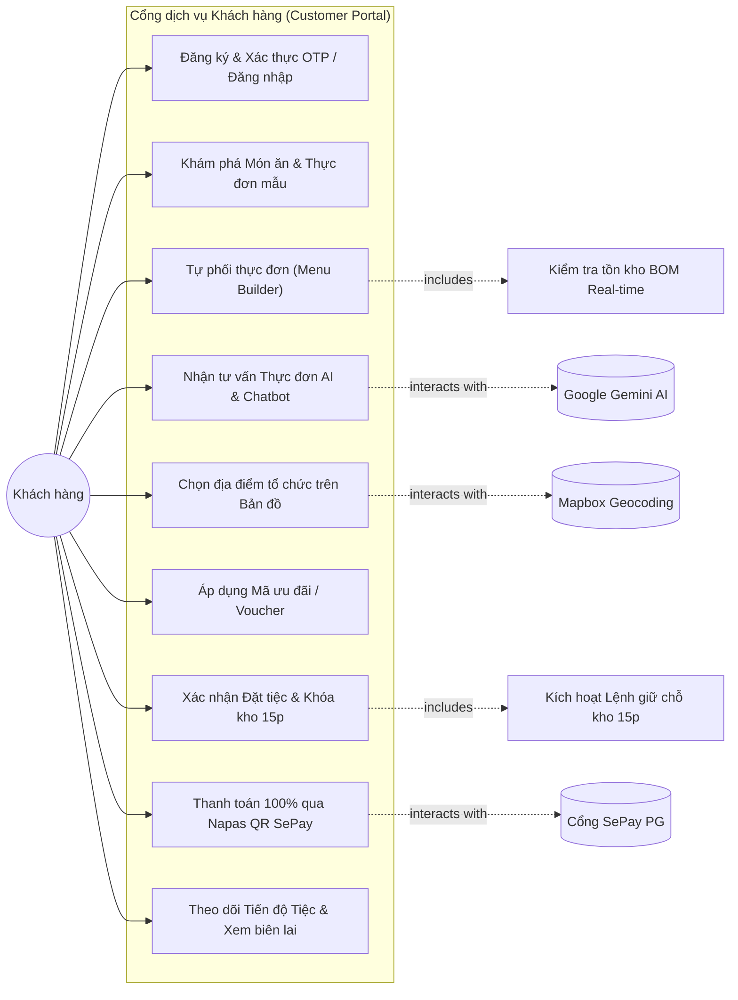
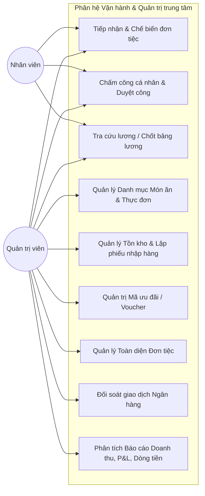

# ĐẶC TẢ USE CASE HỆ THỐNG QUẢN TRỊ ẨM THỰC VÀ ĐẶT TIỆC BANQUETHUB
## USE CASE SPECIFICATION DOCUMENT

> **Dự án**: Nền tảng Đặt Tiệc Cưới & Quản Trị Vận Hành Ẩm Thực Tập Trung BanquetHub  
> **Phiên bản tài liệu**: 2.0  
> **Ngày cập nhật**: 24/11/2026  
> **Tác giả / Phụ trách**: Trần Văn Khiên (tranzankhien@gmail.com)  
> **Mục đích**: Tài liệu đặc tả phân tích thiết kế Use Case chuẩn phục vụ báo cáo Đồ án Tốt nghiệp ngành Kỹ thuật Phần mềm / Công nghệ Thông tin.

---

## MỤC LỤC
1. [GIỚI THIỆU CHUNG & PHẠM VI HỆ THỐNG](#1-giới-thiệu-chung--phạm-vi-hệ-thống)
2. [ĐỊNH DANH TÁC NHÂN (ACTORS)](#2-định-danh-tác-nhân-actors)
3. [SƠ ĐỒ TỔNG QUAN USE CASE (USE CASE DIAGRAMS)](#3-sơ-đồ-tổng-quan-use-case-use-case-diagrams)
4. [MA TRẬN DANH MỤC USE CASE (USE CASE MATRIX)](#4-ma-trận-danh-mục-use-case-use-case-matrix)
5. [ĐẶC TẢ CHI TIẾT CÁC USE CASE TRỌNG TÂM](#5-đặc-tả-chi-tiết-các-use-case-trọng-tâm)
   - [UC-01: Tự phối thực đơn bàn tiệc & Kiểm tra tồn kho thời gian thực](#uc-01-tự-phối-thực-đơn-bàn-tiệc--kiểm-tra-tồn-kho-thời-gian-thực)
   - [UC-02: Tư vấn thực đơn bằng Trợ lý AI Gemini & Chatbot hỗ trợ](#uc-02-tư-vấn-thực-đơn-bằng-trợ-lý-ai-gemini--chatbot-hỗ-trợ)
   - [UC-03: Áp dụng Mã ưu đãi / Voucher giảm giá đơn tiệc](#uc-03-áp-dụng-mã-ưu-đãi--voucher-giảm-giá-đơn-tiệc)
   - [UC-04: Đặt tiệc & Kích hoạt Lệnh khóa giữ kho nguyên liệu 15 phút](#uc-04-đặt-tiệc--kích-hoạt-lệnh-khóa-giữ-kho-nguyên-liệu-15-phút)
   - [UC-05: Thanh toán tự động 100% qua Napas 24/7 QR SePay](#uc-05-thanh-toán-tự-động-100-qua-napas-247-qr-sepay)
   - [UC-06: Tự động hoàn trả tồn kho khi đơn hết hạn thanh toán](#uc-06-tự-động-hoàn-trả-tồn-kho-khi-đơn-hết-hạn-thanh-toán)
   - [UC-07: Tiếp nhận & Cập nhật tiến độ chế biến tiệc (Bếp/Điều phối)](#uc-07-tiếp-nhận--cập-nhật-tiến-độ-chế-biến-tiệc-bếpđiều-phối)
   - [UC-08: Lập phiếu nhập kho nguyên liệu & Cập nhật giá vốn bình quân](#uc-08-lập-phiếu-nhập-kho-nguyên-liệu--cập-nhật-giá-vốn-bình-quân)
   - [UC-09: Quản lý Mã ưu đãi & Cấu hình hạn mức Voucher](#uc-09-quản-lý-mã-ưu-đãi--cấu-hình-hạn-mức-voucher)
   - [UC-10: Đối soát giao dịch thanh toán ngân hàng & Xử lý ngoại lệ](#uc-10-đối-soát-giao-dịch-thanh-toán-ngân-hàng--xử-lý-ngoại-lệ)
   - [UC-11: Chốt kỳ công & Tính bảng lương nhân viên tự động](#uc-11-chốt-kỳ-công--tính-bảng-lương-nhân-viên-tự-động)
   - [UC-12: Báo cáo Phân tích Kết quả Kinh doanh (P&L) và Dòng tiền](#uc-12-báo-cáo-phân-tích-kết-quả-kinh-doanh-pl-và-dòng-tiền)

---

## 1. GIỚI THIỆU CHUNG & PHẠM VI HỆ THỐNG

### 1.1. Bối cảnh & Mục tiêu
BanquetHub là nền tảng quản trị và vận hành ẩm thực yến tiệc chuyên nghiệp, giải quyết bài toán cốt lõi của ngành tiệc cưới - hội nghị: **Đồng bộ thời gian thực giữa Khách đặt tiệc - Kho định mức nguyên liệu (BOM) - Cổng thanh toán trực tuyến - Bếp điều phối - Kế toán & Nhân sự**.

### 1.2. Phạm vi hệ thống (System Scope)
- **Cổng khách hàng (Customer Portal)**: Đăng ký/đăng nhập xác thực Email OTP, khám phá món ăn, chọn thực đơn mẫu hoặc tự phối món từng món/bàn tiệc, tư vấn AI Gemini theo ngân sách/khẩu vị, chọn vị trí tổ chức qua bản đồ Mapbox, nhập voucher chiết khấu, khóa kho giữ nguyên liệu 15 phút, thanh toán 100% qua Napas 24/7 QR SePay và theo dõi tiến độ phục vụ.
- **Cổng nhân viên (Employee Portal)**: Xem danh sách tiệc cần chuẩn bị, cập nhật trạng thái chế biến món ăn, tự chấm công và xem phiếu lương hàng tháng.
- **Cổng quản trị trung tâm (Admin Executive Portal)**: Quản lý danh mục món/thực đơn & công thức định mức (BOM), quản trị kho nguyên liệu (tồn kho, phiếu nhập, sổ biến động kho, quản lý nhà cung cấp, lệnh giữ chỗ), quản lý đơn tiệc, quản lý mã ưu đãi/voucher, đối soát thanh toán trực tuyến SePay, chấm công - tính lương tự động và hệ thống báo cáo tài chính P&L/Dòng tiền chuyên sâu.

---

## 2. ĐỊNH DANH TÁC NHÂN (ACTORS)

| STT | Tên Tác nhân (Actor) | Loại tác nhân | Mô tả vai trò & Quyền hạn trong hệ thống |
|:---:|:---|:---:|:---|
| **1** | **Khách hàng (Customer / User)** | Con người (Primary) | Người dùng cuối truy cập trang web để khám phá thực đơn, tự phối món, nhận tư vấn AI, nhập mã voucher, tạo đơn đặt tiệc và thực hiện chuyển khoản thanh toán 100% qua mã QR. |
| **2** | **Nhân viên (Employee)** | Con người (Primary) | Nhân viên bếp hoặc điều phối sự kiện. Chịu trách nhiệm tiếp nhận thực đơn được giao, xác nhận khâu chuẩn bị nguyên liệu, chuyển trạng thái phục vụ tiệc, chấm công hàng ngày và tra cứu bảng lương. |
| **3** | **Quản trị viên (Admin / Manager)** | Con người (Primary) | Chủ nhà hàng hoặc người điều hành cấp cao. Có toàn quyền quản trị danh mục món, nguyên liệu, phiếu nhập hàng, quản lý đơn tiệc, cấu hình voucher, đối soát tài chính, duyệt bảng lương và xem báo cáo kinh doanh. |
| **4** | **Cổng thanh toán SePay PG** | Hệ thống ngoài (Secondary) | Cổng trung gian thanh toán ngân hàng tự động. Tiếp nhận yêu cầu thanh toán, hiển thị giao diện Napas 24/7 QR, xác thực biên lai và bắn thông báo Webhook IPN về BanquetHub. |
| **5** | **Google Gemini AI API** | Hệ thống ngoài (Secondary) | Dịch vụ trí tuệ nhân tạo thế hệ mới của Google. Nhận dữ liệu thực tế về kho và món ăn từ BanquetHub để tư vấn set menu tối ưu chi phí, dinh dưỡng và khẩu vị theo yêu cầu tự nhiên. |
| **6** | **Dịch vụ Bản đồ Mapbox** | Hệ thống ngoài (Secondary) | Dịch vụ bản đồ số và định vị địa lý. Cung cấp API Geocoding gợi ý địa chỉ tức thì và hiển thị bản đồ trực quan hỗ trợ khách chọn tọa độ tổ chức tiệc chuẩn xác. |
| **7** | **Máy chủ Thư điện tử (SMTP)** | Hệ thống ngoài (Secondary) | Hệ thống gửi email tự động (Gmail SMTP). Chịu trách nhiệm gửi mã xác thực OTP đăng ký, biên lai thanh toán thành công và thông báo tiến độ đơn hàng. |

---

## 3. SƠ ĐỒ TỔNG QUAN USE CASE (USE CASE DIAGRAMS)

### 3.1. Phân hệ Khách hàng (Customer Use Case Diagram)

### 3.2. Phân hệ Nhân viên & Quản trị viên (Employee & Admin Use Case Diagram)

---

## 4. MA TRẬN DANH MỤC USE CASE (USE CASE MATRIX)

| Mã Use Case | Tên Use Case | Phân hệ nghiệp vụ | Tác nhân chính (Primary Actor) | Tác nhân hỗ trợ / Hệ thống ngoài | Mức ưu tiên |
|:---|:---|:---|:---|:---|:---:|
| **UC-AUTH-01** | Đăng ký tài khoản & Xác thực Email OTP | Quản lý Tài khoản | Khách hàng | SMTP Server | Cao |
| **UC-AUTH-02** | Đăng nhập hệ thống & Cấp phát JWT | Quản lý Tài khoản | Khách hàng, NV, Admin | Hệ thống Security | Cao |
| **UC-CAT-01** | Tra cứu danh mục món ăn & Bộ lọc dinh dưỡng | Thực đơn & Món ăn | Khách hàng, NV, Admin | - | Trung bình |
| **UC-CAT-02** | Xem chi tiết món & Thành phần công thức (BOM) | Thực đơn & Món ăn | Khách hàng, NV, Admin | - | Trung bình |
| **UC-BLD-01** | Tự phối thực đơn & Kiểm tra tồn kho khả dụng | Phối món & Đặt tiệc | Khách hàng | - | **Rất cao** |
| **UC-AI-01** | Tư vấn thực đơn bằng Trợ lý AI Gemini & Chatbot | Trí tuệ nhân tạo | Khách hàng | Google Gemini AI | Cao |
| **UC-GEO-01** | Định vị địa điểm tổ chức sự kiện trên Bản đồ | Địa lý & Vận chuyển | Khách hàng | Mapbox Geocoding | Cao |
| **UC-VCH-01** | Áp dụng Mã ưu đãi / Voucher tại bước Đặt tiệc | Khuyến mãi & Chiết khấu | Khách hàng | - | **Rất cao** |
| **UC-ORD-01** | Tạo đơn tiệc & Thiết lập Lệnh khóa giữ kho 15p | Quản lý Đặt tiệc | Khách hàng | - | **Rất cao** |
| **UC-PAY-01** | Thanh toán 100% qua Napas 24/7 QR SePay | Thanh toán trực tuyến | Khách hàng | SePay PG | **Rất cao** |
| **UC-ORD-02** | Tự động hủy đơn & Hoàn kho khi hết hạn 15p | Vận hành kho & Đơn | Hệ thống (Cron Worker) | - | **Rất cao** |
| **UC-ORD-03** | Khách hàng theo dõi tiến độ đơn tiệc thời gian thực | Theo dõi tiệc | Khách hàng | Server-Sent Events | Cao |
| **UC-KIT-01** | Bếp tiếp nhận đơn & Chuyển trạng thái chế biến | Bếp & Điều phối | Nhân viên, Admin | - | Cao |
| **UC-INV-01** | Lập phiếu nhập kho & Cập nhật giá vốn bình quân | Quản lý Kho hàng | Admin | Nhà cung cấp | Cao |
| **UC-INV-02** | Giám sát tồn kho khả dụng & Sổ biến động kho | Quản lý Kho hàng | Admin | - | Cao |
| **UC-VCH-02** | Quản lý danh sách & Cấu hình hạn mức Voucher | Khuyến mãi & Chiết khấu | Admin | - | Cao |
| **UC-FIN-01** | Đối soát giao dịch thanh toán ngân hàng SePay | Kế toán & Đối soát | Admin | SePay API | Cao |
| **UC-HRM-01** | Chấm công hàng ngày & Duyệt bảng công | Nhân sự & Tiền lương | Nhân viên, Admin | - | Trung bình |
| **UC-HRM-02** | Chốt kỳ lương & Tính toán bảng lương tự động | Nhân sự & Tiền lương | Admin | - | Cao |
| **UC-REP-01** | Báo cáo Phân tích Lợi nhuận (P&L) và Dòng tiền | Báo cáo Quản trị | Admin | - | Cao |

---

## 5. ĐẶC TẢ CHI TIẾT CÁC USE CASE TRỌNG TÂM

---

### UC-01: Tự phối thực đơn bàn tiệc & Kiểm tra tồn kho thời gian thực
- **Mã Use Case**: `UC-BLD-01`
- **Tác nhân chính**: Khách hàng (Customer)
- **Mô tả tóm tắt**: Khách hàng chủ động tự chọn các món ăn theo từng nhóm (Khai vị, Món chính, Lẩu & Canh, Tráng miệng, Nước uống) cho bàn tiệc 10 khách. Khi thay đổi số lượng bàn tiệc, hệ thống tự động bóc tách định mức nguyên liệu (BOM) và kiểm tra đối chiếu với tồn kho khả dụng thực tế để báo trước việc có đủ khả năng phục vụ hay không.
- **Tiền điều kiện (Pre-conditions)**:
  1. Danh mục món ăn và định mức công thức nguyên liệu (BOM) đã được cấu hình trong hệ thống.
  2. Bảng nguyên liệu (`ingredients`) có dữ liệu tồn kho thực tế (`current_stock`).
- **Kích hoạt (Trigger)**: Khách hàng truy cập trang Phối thực đơn (`/menu-builder`).
- **Luồng sự kiện chính (Basic Flow)**:
  1. Khách hàng lựa chọn số lượng bàn tiệc dự kiến (Mặc định: 6 bàn = 60 khách, tối thiểu 1 bàn).
  2. Hệ thống hiển thị danh sách các món ăn phân chia theo từng nhóm danh mục kèm đơn giá cho 01 bàn tiệc (10 khách).
  3. Khách hàng bấm **"Chọn món"** hoặc tăng/giảm số lượng đĩa/phần trên mỗi bàn tiệc.
  4. Client tự động gọi API `POST /api/v1/orders/preview` gửi danh sách `{ dishId, quantityPerTable }` và `tableCount`.
  5. Hệ thống Backend tính toán:
     - Tổng số phần ăn từng món: $\text{TotalPortions} = \text{quantityPerTable} \times \text{tableCount}$.
     - Tổng nhu cầu nguyên liệu $j$: $\text{Demand}_j = \sum (\text{TotalPortions}_i \times \text{RecipeQty}_{ij})$.
     - Tồn khả dụng nguyên liệu $j$: $\text{AvailableStock}_j = \text{CurrentStock}_j - \text{ActiveReservedStock}_j$.
  6. Backend xác thực:
     - Nếu $\text{AvailableStock}_j \ge \text{Demand}_j$ với mọi nguyên liệu: Trả về `canProceed = true`, đơn giá 1 bàn (`pricePerTable`), và tổng tạm tính (`totalAmount`).
  7. Giao diện hiển thị bảng kê chi phí realtime, danh sách món đã chọn và bật nút **"Tiếp tục đặt tiệc"**.
- **Luồng thay thế & Ngoại lệ (Alternative / Exception Flows)**:
  - *Luồng ngoại lệ 1 (Kho không đủ nguyên liệu)*: Tại bước 6, nếu có ít nhất một nguyên liệu có $\text{AvailableStock}_j < \text{Demand}_j$, Backend trả về `canProceed = false` kèm danh sách chi tiết các nguyên liệu thiếu hụt. Giao diện hiển thị thông báo cảnh báo màu đỏ và vô hiệu hóa nút đặt tiệc, gợi ý khách hàng giảm số bàn hoặc đổi sang món ăn khác.
  - *Luồng thay thế 2 (Chọn từ thực đơn mẫu)*: Khách hàng chọn một Set Menu định sẵn từ trang `/menus`, sau đó bấm "Chuyển sang công cụ phối món", hệ thống tự động nạp danh sách món của set menu đó vào bảng phối để khách hàng chỉnh sửa thêm/bớt món.
- **Hậu điều kiện (Post-conditions)**: Cấu hình thực đơn được lưu tạm thời vào `sessionStorage` của trình duyệt để sẵn sàng chuyển sang bước Xác nhận đặt tiệc (`/checkout`).

---

### UC-02: Tư vấn thực đơn bằng Trợ lý AI Gemini & Chatbot hỗ trợ
- **Mã Use Case**: `UC-AI-01`
- **Tác nhân chính**: Khách hàng (Customer)
- **Tác nhân hỗ trợ**: Google Gemini AI API
- **Mô tả tóm tắt**: Khách hàng nhập mô tả nhu cầu tiệc bằng ngôn ngữ tự nhiên (ngân sách dự kiến, tính chất tiệc cưới/sinh nhật, yêu cầu khẩu vị). Trí tuệ nhân tạo Gemini phối hợp với cơ sở dữ liệu món ăn và định mức tồn kho thực tế của BanquetHub để gợi ý set menu tối ưu, có thể nhấn "Chọn set menu này" để đưa ngay vào quy trình đặt tiệc. Chatbot góc màn hình cũng hỗ trợ giải đáp chính sách dịch vụ và điều khoản hợp đồng.
- **Tiền điều kiện (Pre-conditions)**: Hệ thống đã cấu hình API Key Google Gemini hợp lệ và dịch vụ AI hoạt động bình thường.
- **Kích hoạt (Trigger)**: Khách hàng truy cập trang `/ai-menu` hoặc mở Chatbot Widget ở góc dưới bên phải màn hình.
- **Luồng sự kiện chính (Basic Flow - AI Menu Generator)**:
  1. Khách hàng nhập số lượng khách/số bàn tiệc, ngân sách dự kiến (cho mỗi bàn hoặc tổng ngân sách), phong cách tiệc (Hiện đại, Truyền thống, Hải sản, Chay...) và các ghi chú đặc biệt (ví dụ: "không ăn cay, nhiều món bò").
  2. Khách hàng bấm **"AI đề xuất thực đơn"**.
  3. Backend truy vấn danh mục món ăn đang hoạt động và số lượng tồn kho khả dụng từ cơ sở dữ liệu.
  4. Backend tạo cấu trúc Prompt chặt chẽ (Grounding with real DB) bao gồm danh sách món ăn, ID, đơn giá và tình trạng sẵn có, gửi tới Google Gemini API.
  5. Gemini phân tích và trả về cấu trúc JSON gồm: Tên set menu đề xuất, lý do phối vị dinh dưỡng, phân bổ món từ khai vị đến tráng miệng, tổng chi phí tính toán.
  6. Backend nhận kết quả, thẩm định lại tính hợp lệ của các `dishId` và giá bán trong DB.
  7. Giao diện hiển thị các phương án thực đơn gợi ý trực quan, kèm nút **"Áp dụng thực đơn này"**.
  8. Khách hàng bấm chọn, hệ thống tự động chuyển toàn bộ món ăn vào Studio phối món hoặc trang Checkout.
- **Luồng thay thế & Ngoại lệ (Chatbot Widget & Chính sách)**:
  - *Luồng hỏi đáp chính sách hoàn tiền / hủy tiệc*: Khi khách hàng hỏi Chatbot về việc "Có hoàn tiền không?", Chatbot tuân thủ nghiêm ngặt chỉ dẫn hệ thống: Trả lời rõ ràng BanquetHub **không hoàn tiền tự động**, chính sách hủy tiệc và bảo lưu chi phí phụ thuộc vào Hợp đồng dịch vụ thỏa thuận cụ thể và thời điểm thông báo trước ngày tiệc.
  - *Luồng ngoại lệ (Gemini API lỗi hoặc quá tải)*: Backend tự động kích hoạt thuật toán dự phòng (Rule-based Fallback Service) chọn lọc set menu cân bằng dinh dưỡng từ DB có sẵn để trả về cho người dùng mà không làm gián đoạn trải nghiệm.
- **Hậu điều kiện (Post-conditions)**: Thực đơn được AI gợi ý sẵn sàng để khách chuyển sang bước Đặt tiệc.

---

### UC-03: Áp dụng Mã ưu đãi / Voucher giảm giá đơn tiệc
- **Mã Use Case**: `UC-VCH-01`
- **Tác nhân chính**: Khách hàng (Customer)
- **Mô tả tóm tắt**: Khách hàng tự tay nhập mã voucher khuyến mãi tại giao diện thanh toán đơn tiệc (`/checkout`). Hệ thống kiểm tra tính hợp lệ của mã (trạng thái kích hoạt, thời hạn hiệu lực, giá trị đơn tối thiểu, số lượt dùng toàn sàn, số lượt dùng/mỗi khách hàng), tính toán mức chiết khấu (tiền mặt cố định hoặc % có chặn trần) và khấu trừ trực tiếp vào tổng tiền cần thanh toán 100%.
- **Tiền điều kiện (Pre-conditions)**:
  1. Khách hàng đang ở màn hình Xác nhận đặt tiệc (`/checkout`) và đã có bảng báo giá xem trước (`preview.totalAmount`).
  2. Mã voucher đã được cấu hình hợp lệ trên hệ thống Admin.
- **Kích hoạt (Trigger)**: Khách hàng gõ mã voucher vào ô nhập và bấm nút **"Áp dụng"**.
- **Luồng sự kiện chính (Basic Flow)**:
  1. Khách hàng nhập mã khuyến mãi (ví dụ: `TIECXUAN2026`) vào ô "Mã ưu đãi / Voucher". Hệ thống tự động chuyển đổi sang chữ in hoa.
  2. Khách hàng bấm **"Áp dụng"**.
  3. Client gửi yêu cầu `POST /api/v1/vouchers/apply` với `{ code: "TIECXUAN2026", orderAmount: 14760000 }`.
  4. Backend kiểm tra các điều kiện:
     - Mã voucher tồn tại trong bảng `vouchers` và đang ở trạng thái `is_active = true`.
     - Thời gian hiện tại nằm trong khoảng `start_date` đến `end_date`.
     - Giá trị đơn hàng $\ge$ `min_order_amount`.
     - Số lượt đã dùng (`used_count`) < Tổng lượt phát hành (`usage_limit`).
     - Khách hàng hiện tại chưa vượt quá số lượt cho phép (`limit_per_user`) dựa trên lịch sử bảng `voucher_usages`.
  5. Backend tính mức giảm giá:
     - Nếu `discountType == 'FIXED'`: Giảm đúng giá trị `discountValue`.
     - Nếu `discountType == 'PERCENTAGE'`: $\text{Discount} = \text{OrderAmount} \times \frac{\text{Value}}{100}$. Nếu vượt quá `maxDiscountAmount` thì áp dụng trần `maxDiscountAmount`.
  6. Backend tính số tiền thanh toán cuối cùng: $\text{FinalAmount} = \max(0, \text{OrderAmount} - \text{Discount})$.
  7. Backend trả về kết quả thành công: `{ valid: true, voucherCode, voucherName, discountAmount, finalAmount }`.
  8. Giao diện Checkout hiển thị huy hiệu voucher đã áp dụng màu xanh lá, bổ sung dòng:
     - `Tạm tính đơn tiệc: 14.760.000 ₫`
     - `Giảm giá voucher (TIECXUAN2026): -500.000 ₫`
     - `Tổng thanh toán (100%): 14.260.000 ₫`
- **Luồng thay thế & Ngoại lệ (Alternative / Exception Flows)**:
  - *Luồng ngoại lệ 1 (Mã không tồn tại hoặc hết hạn)*: Backend trả về `valid = false` kèm thông báo lỗi cụ thể. Giao diện hiển thị cảnh báo đỏ và giữ nguyên tổng tiền gốc.
  - *Luồng ngoại lệ 2 (Đơn chưa đạt giá trị tối thiểu)*: Khách hàng nhập mã dành cho đơn từ 15 triệu trong khi đơn hiện tại chỉ 10 triệu. Hệ thống báo lỗi: *"Đơn tiệc chưa đạt giá trị tối thiểu 15.000.000 ₫ để áp dụng voucher này"*.
  - *Luồng thay thế 3 (Khách thay đổi số lượng bàn)*: Sau khi đã áp dụng voucher, khách hàng giảm số bàn khiến tổng tiền giảm xuống dưới mức `min_order_amount`. Khi gọi lại hàm tính giá, hệ thống tự động gỡ bỏ voucher và thông báo: *"Mã TIECXUAN2026 đã tự động gỡ vì đơn tiệc không còn đạt giá trị tối thiểu"*.
  - *Luồng thay thế 4 (Khách bấm gỡ mã thủ công)*: Khách bấm icon `X` tại ô voucher đã áp dụng, hệ thống gỡ mã và hoàn trả tổng tiền thanh toán về giá trị tạm tính ban đầu.
- **Hậu điều kiện (Post-conditions)**: Thông tin voucher (`voucherCode`) được lưu vào trạng thái đơn hàng để gửi kèm payload tạo đơn `POST /api/v1/orders`.

---

### UC-04: Đặt tiệc & Kích hoạt Lệnh khóa giữ kho nguyên liệu 15 phút
- **Mã Use Case**: `UC-ORD-01`
- **Tác nhân chính**: Khách hàng (Customer)
- **Mô tả tóm tắt**: Khách hàng điền đầy đủ thông tin tổ chức tiệc (Họ tên, số điện thoại, ngày giờ tiệc, địa điểm chọn từ Mapbox) và nhấn "Xác nhận đặt tiệc". Hệ thống thiết lập giao dịch khóa bi quan (Pessimistic Lock) trong DB, đối soát tồn kho lần cuối, ghi nhận đơn hàng với trạng thái `PENDING_PAYMENT`, đồng thời tạo lệnh `StockReservation` khóa giữ toàn bộ định mức nguyên liệu trong 15 phút. Khách hàng cần hoàn tất thanh toán 100% trong thời hạn này.
- **Tiền điều kiện (Pre-conditions)**:
  1. Khách hàng đã đăng nhập tài khoản hợp lệ.
  2. Bảng tính giá xem trước (`preview`) hợp lệ, đồng bộ đúng số bàn hiện tại và `canProceed = true`.
- **Kích hoạt (Trigger)**: Khách hàng nhấn nút **"Xác nhận đặt tiệc"**.
- **Luồng sự kiện chính (Basic Flow)**:
  1. Khách hàng kiểm tra thông tin liên hệ, tọa độ sự kiện từ Mapbox, ghi chú tiệc và mã voucher (nếu có).
  2. Khách hàng bấm **"Xác nhận đặt tiệc"**.
  3. Client sinh khóa `Idempotency-Key` duy nhất và gửi yêu cầu `POST /api/v1/orders` kèm `expectedTotalAmount` (số tiền sau chiết khấu voucher) và `voucherCode`.
  4. Backend mở giao dịch cơ sở dữ liệu (`@Transactional`):
     - Khóa bi quan (`PESSIMISTIC_WRITE`) các bản ghi nguyên liệu liên quan trong bảng `ingredients`.
     - Tính toán lại toàn bộ đơn giá, kiểm tra tồn kho khả dụng lần cuối.
     - Khấu trừ voucher hợp lệ và xác thực số tiền khớp chính xác với `expectedTotalAmount`.
     - Tạo bản ghi `orders` với `order_status = 'PENDING_PAYMENT'`, `payment_status = 'UNPAID'`, `subtotal_amount`, `discount_amount`, `voucher_code`, và thời hạn `payment_expires_at = NOW() + 15 phút`.
     - Tạo bản ghi `stock_reservations` với `status = 'ACTIVE'`, liên kết chi tiết từng số lượng nguyên liệu giữ chỗ trong `stock_reservation_items`.
     - Ghi nhận lịch sử sử dụng voucher vào bảng `voucher_usages` và tăng `used_count` của voucher lên 1.
  5. Backend hoàn tất commit giao dịch và trả về thông tin đơn tiệc vừa tạo (`OrderResponse`).
  6. Giao diện chuyển hướng khách hàng sang trang **Xác nhận đặt tiệc thành công** (`/orders/confirmation/{id}`) có đồng hồ đếm ngược 15:00 giữ kho nguyên liệu.
- **Luồng thay thế & Ngoại lệ (Alternative / Exception Flows)**:
  - *Luồng ngoại lệ 1 (Xung đột tồn kho vào phút chót)*: Trong quá trình khách điền form, một đơn khác đã thanh toán làm cạn kiệt nguyên liệu. Tại bước 4, hệ thống rollback giao dịch, trả về mã lỗi `OUT_OF_STOCK` kèm thông báo nguyên liệu không đủ.
  - *Luồng ngoại lệ 2 (Bất đồng bộ giá / Trượt giá)*: Đơn giá món ăn được Admin cập nhật trong lúc khách đang mở trang. Backend phát hiện `expectedTotalAmount` không khớp với giá tính lại, từ chối tạo đơn và yêu cầu khách hàng làm mới lại báo giá.
  - *Luồng ngoại lệ 3 (Lặp yêu cầu)*: Khách hàng bấm nút nhiều lần liên tiếp, hệ thống dựa vào `Idempotency-Key` để trả về đúng đơn hàng đã tạo của lần bấm đầu tiên, không tạo đơn trùng lặp.
- **Hậu điều kiện (Post-conditions)**:
  - Đơn tiệc ở trạng thái `PENDING_PAYMENT`.
  - Nguyên liệu bị khóa giữ chỗ trong 15 phút (không trừ kho vật lý nhưng trừ khỏi tồn khả dụng).
  - Đồng hồ đếm ngược 15 phút bắt đầu hoạt động trên giao diện.

---

### UC-05: Thanh toán tự động 100% qua Napas 24/7 QR SePay
- **Mã Use Case**: `UC-PAY-01`
- **Tác nhân chính**: Khách hàng (Customer)
- **Tác nhân hỗ trợ**: Cổng thanh toán SePay PG
- **Mô tả tóm tắt**: Khách hàng bấm thanh toán để mở giao diện cổng SePay, thực hiện quét mã QR Napas 24/7 chuyển khoản đúng số tiền (100% giá trị đơn hàng sau khi trừ voucher). Cổng SePay gửi thông báo Webhook IPN về BanquetHub. Hệ thống tự động xác thực chữ ký bảo mật, chuyển đơn hàng sang `PAID`, xác nhận lệnh giữ kho thành `CONFIRMED`, xuất hóa đơn và lập lịch gửi email xác nhận.
- **Tiền điều kiện (Pre-conditions)**:
  1. Đơn hàng đang ở trạng thái `PENDING_PAYMENT`, `payment_status = 'UNPAID'`.
  2. Thời hạn giữ kho 15 phút chưa kết thúc (`expires_at > NOW()`).
- **Kích hoạt (Trigger)**: Khách hàng bấm nút **"Thanh toán ngay qua SePay >"** trên chi tiết đơn hàng.
- **Luồng sự kiện chính (Basic Flow)**:
  1. Khách hàng bấm **"Thanh toán ngay qua SePay >"**.
  2. Client gọi API `POST /api/v1/payments/{orderId}/create`.
  3. Backend tạo chữ ký HMAC-SHA256, sinh URL chuyển tiếp và trả về form thanh toán chuẩn của SePay Sandbox/Production.
  4. Trình duyệt tự động chuyển hướng khách hàng sang cổng SePay hiển thị mã QR VietQR / Napas 24/7 kèm nội dung chuyển khoản độc nhất.
  5. Khách hàng dùng ứng dụng ngân hàng (Mobile Banking) quét mã QR và xác nhận chuyển khoản thành công.
  6. Ngân hàng ghi nhận tiền vào tài khoản và SePay lập tức bắn tín hiệu Webhook IPN (`POST /api/v1/payments/webhook`) về máy chủ BanquetHub kèm chữ ký xác thực trong Header `X-Secret-Key`.
  7. Backend BanquetHub tiếp nhận Webhook:
     - Xác thực Secret Key của merchant.
     - Khóa bản ghi đơn hàng và giao dịch trong DB.
     - Kiểm tra số tiền chuyển khớp chính xác với `order.total_amount` và mã tham chiếu giao dịch.
     - Chuyển `order.order_status = 'PAID'`, `order.payment_status = 'PAID'`.
     - Cập nhật lệnh giữ kho `stock_reservations.status = 'CONFIRMED'`.
     - Ghi nhận giao dịch vào bảng `payment_transactions` (mã giao dịch, ngân hàng, thời gian thanh toán).
     - Tạo tác vụ gửi email thông báo biên lai đặt tiệc vào hàng đợi `email_outbox`.
  8. Hệ thống phát sự kiện thời gian thực (SSE / Event Dispatcher).
  9. Trình duyệt khách hàng tự động cập nhật ngay lập tức: Chuyển sang giao diện **"Đơn tiệc đã thanh toán thành công"** màu xanh lá, tắt đồng hồ đếm ngược và hiển thị biên lai dịch vụ.
- **Luồng thay thế & Ngoại lệ (Alternative / Exception Flows)**:
  - *Luồng ngoại lệ 1 (Tiền về sau khi hết hạn 15 phút)*: Khách hàng chuyển khoản chậm trễ khi lệnh giữ kho đã hết hạn và nguyên liệu đã bị đơn khác chiếm dụng. Hệ thống chuyển trạng thái thanh toán sang `PAYMENT_REVIEW` (Chờ đối soát thủ công), không kích hoạt đơn tự động để tránh xung đột kho và hiển thị thông báo để kế toán xử lý.
  - *Luồng ngoại lệ 2 (Sai lệch số tiền chuyển khoản)*: Số tiền chuyển không khớp với giá trị đơn. Hệ thống ghi nhận trạng thái cảnh báo và gửi thông báo đối soát cho quản trị viên.
- **Hậu điều kiện (Post-conditions)**:
  - Đơn hàng chuyển sang `PAID`, sẵn sàng để bếp tiếp nhận chế biến.
  - Lệnh giữ kho được chốt cố định cho đơn hàng.
  - Khách hàng nhận được email biên lai xác nhận.

---

### UC-06: Tự động hoàn trả tồn kho khi đơn hết hạn thanh toán
- **Mã Use Case**: `UC-ORD-02`
- **Tác nhân chính**: Hệ thống (Background Cron Worker)
- **Mô tả tóm tắt**: Hệ thống chạy tác vụ định kỳ ngầm (Scheduled Worker) quét các đơn hàng quá hạn 15 phút mà chưa nhận được xác nhận thanh toán thành công từ cổng SePay. Hệ thống tự động chuyển trạng thái đơn sang `EXPIRED`, giải phóng lệnh giữ chỗ (`RELEASED`), trả lại toàn bộ định mức nguyên liệu về tồn khả dụng cho các khách hàng khác đặt tiệc.
- **Tiền điều kiện (Pre-conditions)**: Có các đơn hàng `PENDING_PAYMENT` có `payment_expires_at < NOW()`.
- **Kích hoạt (Trigger)**: Tác vụ `ReservationExpiryWorker` chạy tự động mỗi phút.
- **Luồng sự kiện chính (Basic Flow)**:
  1. Worker truy vấn tất cả các bản ghi `stock_reservations` có `status = 'ACTIVE'` và `expires_at <= NOW()`.
  2. Với mỗi lệnh giữ chỗ quá hạn:
     - Mở giao dịch cập nhật trạng thái `stock_reservations.status = 'RELEASED'` và gán `released_at = NOW()`.
     - Cập nhật đơn hàng tương ứng `orders.order_status = 'EXPIRED'`.
     - Ghi lại nhật ký tiến độ: *"Đơn tiệc hết hạn thanh toán giữ chỗ 15 phút. Toàn bộ nguyên liệu đã được tự động hoàn lại kho khả dụng"*.
  3. Giao dịch commit: Toàn bộ định mức nguyên liệu ngay lập tức được cộng ngược lại vào số dư tồn kho khả dụng ($\text{Available Stock}$).
- **Luồng thay thế & Khách xem đơn**: Khi khách hàng đang mở trang chi tiết đơn hoặc danh sách `/my-orders`, đồng hồ đếm ngược về 00:00, thẻ trạng thái tự động chuyển thành **"Hết hạn giữ chỗ"**, ẩn nút thanh toán và hiển thị nút **"Tái tạo đơn tiệc này"** để hỗ trợ khách đặt lại nếu có nhu cầu.
- **Hậu điều kiện (Post-conditions)**: Nguyên liệu được giải phóng, kho hàng không bị giam ảo, đảm bảo tính sẵn sàng tối đa cho kinh doanh.

---

### UC-07: Tiếp nhận & Cập nhật tiến độ chế biến tiệc (Bếp/Điều phối)
- **Mã Use Case**: `UC-KIT-01`
- **Tác nhân chính**: Nhân viên bếp / Điều phối (Employee), Quản trị viên (Admin)
- **Mô tả tóm tắt**: Nhân viên bếp đăng nhập vào phân hệ `/employee/orders` để xem danh sách các đơn tiệc đã thanh toán hợp lệ (`PAID`). Nhân viên tiếp nhận đơn, thực hiện xuất kho thực tế, chuyển trạng thái đơn sang `PREPARING` (Đang chuẩn bị tiệc / nấu bếp) và cuối cùng là `COMPLETED` (Hoàn thành buổi tiệc).
- **Tiền điều kiện (Pre-conditions)**: Đơn hàng đã ở trạng thái `PAID`.
- **Kích hoạt (Trigger)**: Nhân viên chọn một đơn hàng từ danh sách điều phối tiệc.
- **Luồng sự kiện chính (Basic Flow)**:
  1. Nhân viên xem bảng thông tin chuẩn bị tiệc: Số lượng bàn, giờ tiệc, danh sách món ăn, tổng số phần ăn và danh sách định mức nguyên liệu cần xuất cho ca nấu.
  2. Nhân viên bấm nút **"Tiếp nhận & Bắt đầu chuẩn bị"**.
  3. Hệ thống cập nhật:
     - Chuyển `orders.order_status = 'PREPARING'`.
     - Ghi nhận biến động xuất kho vật lý (`stock_movements` với loại `EXPORT_ORDER`), trừ trực tiếp vào `ingredients.current_stock`.
     - Cập nhật lịch sử tiến độ đơn hàng kèm định danh nhân viên thực hiện.
  4. Sau khi sự kiện tiệc kết thúc tốt đẹp, nhân viên/quản lý bấm **"Xác nhận hoàn thành tiệc"**.
  5. Hệ thống chuyển `orders.order_status = 'COMPLETED'` và ghi sổ kết thúc hợp đồng tiệc.
- **Hậu điều kiện (Post-conditions)**: Đơn tiệc hoàn tất chu trình phục vụ, dữ liệu được ghi nhận vào báo cáo doanh thu và chi phí giá vốn thực tế.

---

### UC-08: Lập phiếu nhập kho nguyên liệu & Cập nhật giá vốn bình quân
- **Mã Use Case**: `UC-INV-01`
- **Tác nhân chính**: Quản trị viên / Thủ kho (Admin)
- **Tác nhân hỗ trợ**: Nhà cung cấp (Supplier)
- **Mô tả tóm tắt**: Quản trị viên tạo phiếu nhập hàng từ nhà cung cấp đối tác. Khi xác nhận nhập kho, số lượng nguyên liệu thực tế được cộng dồn vào kho, hệ thống tự động tính toán lại đơn giá vốn bình quân gia quyền (Moving Average Cost) và ghi nhận công nợ nhà cung cấp.
- **Tiền điều kiện (Pre-conditions)**: Nhà cung cấp và danh mục nguyên liệu đã được khai báo trên hệ thống.
- **Kích hoạt (Trigger)**: Quản trị viên truy cập `/admin/inventory/receipts/new`.
- **Luồng sự kiện chính (Basic Flow)**:
  1. Admin chọn Nhà cung cấp từ danh sách đối tác.
  2. Thêm các dòng nguyên liệu nhập kho: Chọn nguyên liệu, số lượng nhập, đơn giá nhập thực tế.
  3. Hệ thống tính tổng tiền phiếu nhập: $\text{TotalReceipt} = \sum (\text{Qty}_k \times \text{UnitPrice}_k)$.
  4. Admin nhập số tiền đã thanh toán cho nhà cung cấp (nếu thanh toán một phần hoặc trả sau) và bấm **"Xác nhận nhập kho"**.
  5. Hệ thống thực hiện trong một Transaction:
     - Tạo phiếu nhập `stock_receipts` với trạng thái `CONFIRMED`.
     - Với từng nguyên liệu $j$, tính lại đơn giá vốn bình quân mới:
       $$\text{NewUnitCost}_j = \frac{(\text{OldStock}_j \times \text{OldUnitCost}_j) + (\text{ImportQty}_j \times \text{ImportPrice}_j)}{\text{OldStock}_j + \text{ImportQty}_j}$$
     - Cập nhật $\text{CurrentStock}_j = \text{OldStock}_j + \text{ImportQty}_j$ và gán đơn giá vốn mới.
     - Ghi bản ghi vào sổ biến động kho `stock_movements` (Loại: `IMPORT_RECEIPT`).
     - Cập nhật số dư công nợ của nhà cung cấp.
  6. Hệ thống hiển thị thông báo nhập kho thành công và cập nhật tức thì vào bảng tổng quan kho.
- **Hậu điều kiện (Post-conditions)**: Tồn kho vật lý và tồn khả dụng tăng lên, giá vốn bình quân được cập nhật chính xác làm cơ sở tính giá thành món ăn.

---

### UC-09: Quản lý Mã ưu đãi & Cấu hình hạn mức Voucher
- **Mã Use Case**: `UC-VCH-02`
- **Tác nhân chính**: Quản trị viên (Admin)
- **Mô tả tóm tắt**: Quản trị viên quản lý toàn diện các chương trình khuyến mãi và mã voucher: tạo mã mới, cấu hình hình thức giảm (tiền cố định / % có chặn trần), thiết lập điều kiện giá trị đơn tối thiểu, tổng số lượt sử dụng toàn sàn, số lượt dùng/mỗi khách và thời gian hiệu lực. Admin có thể bật/tắt kích hoạt voucher tức thì hoặc xóa voucher.
- **Tiền điều kiện (Pre-conditions)**: Đăng nhập với tài khoản có quyền `ROLE_ADMIN`.
- **Kích hoạt (Trigger)**: Truy cập trang Quản lý Voucher (`/admin/vouchers`).
- **Luồng sự kiện chính (Basic Flow - Tạo Voucher mới)**:
  1. Admin bấm nút **"Thêm voucher mới"**. Modal tạo voucher mở ra.
  2. Admin nhập các thông số:
     - Mã voucher (Ví dụ: `BANQUET10` - tự động chuyển chữ in hoa).
     - Tên chương trình ưu đãi (Ví dụ: "Tri ân tiệc cưới mùa yêu thương").
     - Loại giảm giá: Chọn `Số tiền cố định (VNĐ)` hoặc `Theo phần trăm (%)`.
     - Giá trị giảm: Nhập số tiền hoặc số %.
     - Mức giảm tối đa: (Khuyên dùng khi chọn %, ví dụ: trần tối đa 1.500.000 ₫ để ngăn rủi ro đơn tiệc quy mô cực lớn).
     - Giá trị đơn tối thiểu: (Ví dụ: 8.000.000 ₫).
     - Hạn mức sử dụng: Tổng lượt áp dụng toàn sàn (Ví dụ: 100 lượt) và số lượt/mỗi khách (Ví dụ: 1 lượt/khách).
     - Thời gian hiệu lực: Chọn ngày giờ bắt đầu và kết thúc.
     - Đánh dấu "Kích hoạt voucher này ngay sau khi lưu".
  3. Admin bấm **"Tạo voucher"**.
  4. Backend xác thực tính hợp lệ (mã không được trùng, giá trị giảm > 0, % từ 1-100) và lưu vào bảng `vouchers`.
  5. Bảng danh sách voucher lập tức hiển thị mã mới tạo kèm đầy đủ chỉ số thống kê.
- **Luồng thay thế (Bật / Tắt trạng thái nhanh)**:
  - Trên bảng danh mục, Admin bấm vào nút trạng thái của voucher, hệ thống gọi API `PATCH /api/v1/admin/vouchers/{id}/toggle-status` để chuyển đổi tức thì giữa `Hoạt động` và `Tạm ngưng` mà không cần vào form chỉnh sửa. Khi tạm ngưng, khách hàng nhập mã ở Checkout sẽ bị từ chối ngay lập tức.
- **Hậu điều kiện (Post-conditions)**: Chương trình voucher được lưu trữ, kiểm soát chặt chẽ ngân sách chiết khấu của nhà hàng.

---

### UC-10: Đối soát giao dịch thanh toán ngân hàng & Xử lý ngoại lệ
- **Mã Use Case**: `UC-FIN-01`
- **Tác nhân chính**: Quản trị viên / Kế toán (Admin)
- **Tác nhân hỗ trợ**: SePay Payment Gateway API
- **Mô tả tóm tắt**: Quản trị viên theo dõi toàn bộ dòng tiền thanh toán trực tuyến qua cổng SePay. Hệ thống đối chiếu tự động giữa lịch sử giao dịch ngân hàng và đơn đặt tiệc. Trường hợp có phát sinh thanh toán trễ hạn giữ kho hoặc sai số tiền, kế toán có công cụ tra cứu mã chứng từ, thực hiện khớp đơn thủ công hoặc đóng đối soát an toàn.
- **Tiền điều kiện (Pre-conditions)**: Đăng nhập quyền `ROLE_ADMIN`, truy cập `/admin/payments`.
- **Kích hoạt (Trigger)**: Kế toán mở trang Quản lý Thanh toán & Đối soát.
- **Luồng sự kiện chính (Basic Flow)**:
  1. Hệ thống hiển thị danh sách toàn bộ các giao dịch qua SePay kèm trạng thái đối soát: `Đã khớp tự động (MATCHED)`, `Chờ đối soát (PENDING_REVIEW)`, `Không khớp (UNMATCHED)`.
  2. Kế toán có thể lọc theo khoảng ngày, trạng thái hoặc tìm kiếm theo mã đơn tiệc / mã tham chiếu ngân hàng.
  3. Kế toán bấm **"Kiểm tra cổng SePay"** để đồng bộ những giao dịch mới nhất từ API SePay về hệ thống.
  4. Khi có giao dịch thanh toán chậm trễ cần đối soát thủ công (Đơn tiệc đã `EXPIRED` nhưng tiền thực tế đã vào tài khoản):
     - Kế toán mở chi tiết giao dịch, kiểm tra số tiền thực nhận.
     - Trao đổi với bếp và kho: Nếu kho vẫn đáp ứng đủ nguyên liệu, kế toán bấm **"Xác nhận kích hoạt đơn thủ công"**.
     - Hệ thống phục hồi đơn sang `PAID`, xác nhận giữ kho và ghi nhận lịch sử kiểm toán của Kế toán viên.
- **Hậu điều kiện (Post-conditions)**: Số liệu tài chính giữa tài khoản ngân hàng thực tế và sổ sách đơn hàng trên hệ thống luôn khớp 100%.

---

### UC-11: Chốt kỳ công & Tính bảng lương nhân viên tự động
- **Mã Use Case**: `UC-HRM-02`
- **Tác nhân chính**: Quản trị viên / Kế toán nhân sự (Admin)
- **Mô tả tóm tắt**: Vào cuối mỗi tháng, quản trị viên tạo kỳ lương, chốt dữ liệu chấm công của toàn bộ nhân viên. Hệ thống tự động tổng hợp số ngày công thực tế, tính lương cơ bản theo ngày, các khoản phụ cấp trách nhiệm, tính tiền phạt đi trễ/nghỉ không phép và xuất ra bảng thanh toán lương (Payroll) hoàn chỉnh.
- **Tiền điều kiện (Pre-conditions)**: Hồ sơ nhân viên đã có mức lương cơ bản và dữ liệu chấm công trong tháng đã được ghi nhận.
- **Kích hoạt (Trigger)**: Truy cập `/admin/payroll-periods` và chọn **"Tạo kỳ lương mới"**.
- **Luồng sự kiện chính (Basic Flow)**:
  1. Admin tạo kỳ lương cho tháng (Ví dụ: Tháng 11/2026, từ ngày 01/11 đến 30/11) với số ngày công chuẩn (Ví dụ: 26 ngày).
  2. Admin bấm **"Chốt công & Tính lương tự động"**.
  3. Backend quét toàn bộ nhân viên đang hoạt động và dữ liệu bảng `attendances` trong tháng:
     - Tính tổng công chuẩn: $\text{ActualWorkDays} = \text{PresentDays} + (\text{HalfDays} \times 0.5)$.
     - Tính lương thực tế: $\text{CalculatedSalary} = \frac{\text{BaseSalary}}{\text{StandardWorkDays}} \times \text{ActualWorkDays}$.
     - Cộng phụ cấp chức vụ, thưởng hoàn thành tiệc.
     - Trừ các khoản giảm trừ (nghỉ không lương, tạm ứng).
     - Tính lương thực nhận: $\text{NetSalary} = \text{CalculatedSalary} + \text{Allowances} - \text{Deductions}$.
  4. Hệ thống lưu kết quả vào bảng `payrolls` với trạng thái `PENDING_APPROVAL`.
  5. Admin kiểm tra tổng thể bảng lương toàn công ty, sau đó bấm **"Phê duyệt bảng lương"** và tiến hành tạo phiếu chi thanh toán lương (`salary-payments`).
  6. Sau khi phê duyệt, nhân viên có thể đăng nhập vào cổng cá nhân `/employee/payrolls` để xem chi tiết phiếu lương của mình.
- **Hậu điều kiện (Post-conditions)**: Bảng lương được chốt số liệu, chi phí lương tự động kết chuyển vào Báo cáo Chi phí & Lợi nhuận của doanh nghiệp.

---

### UC-12: Báo cáo Phân tích Kết quả Kinh doanh (P&L) và Dòng tiền
- **Mã Use Case**: `UC-REP-01`
- **Tác nhân chính**: Quản trị viên / Giám đốc điều hành (Admin)
- **Mô tả tóm tắt**: Hệ thống tự động tổng hợp toàn diện các dòng dữ liệu tài chính từ Đơn đặt tiệc đã thanh toán (Doanh thu), Phiếu xuất kho nguyên liệu theo giá vốn bình quân (Giá vốn hàng bán - COGS), Bảng thanh toán lương nhân viên (Chi phí nhân sự) và Chi phí vận hành khác (Điện, nước, mặt bằng) để lập Báo cáo Kết quả Hoạt động Kinh doanh (P&L) và Báo cáo Lưu chuyển Tiền tệ (Cash Flow).
- **Tiền điều kiện (Pre-conditions)**: Hệ thống có phát sinh đơn hàng, xuất nhập kho và kỳ lương.
- **Kích hoạt (Trigger)**: Truy cập `/admin/reports/profit` hoặc `/admin/reports/cashflow`.
- **Luồng sự kiện chính (Basic Flow - Báo cáo Lợi nhuận P&L)**:
  1. Admin chọn khoảng thời gian phân tích (Theo tháng, quý, năm hoặc tùy chọn ngày).
  2. Hệ thống tính toán các chỉ số kinh doanh then chốt theo chuẩn kế toán:
     - **Doanh thu thuần (Net Revenue)**: Tổng giá trị các đơn tiệc `PAID` và `COMPLETED` sau khi đã trừ chiết khấu voucher.
     - **Giá vốn hàng bán (COGS)**: Tổng giá trị xuất kho nguyên liệu thực tế cho các tiệc trong kỳ theo giá vốn bình quân gia quyền.
     - **Lợi nhuận gộp (Gross Profit)**: $\text{Gross Profit} = \text{Net Revenue} - \text{COGS}$.
     - **Tỷ suất lợi nhuận gộp (Gross Margin %)**: $\frac{\text{Gross Profit}}{\text{Net Revenue}} \times 100\%$.
     - **Chi phí vận hành (Operating Expenses - OPEX)**: Chi phí lương nhân viên + Chi phí mặt bằng, điện nước, khấu hao công cụ dụng cụ.
     - **Lợi nhuận thuần trước thuế (Net Profit)**: $\text{Net Profit} = \text{Gross Profit} - \text{OPEX}$.
  3. Giao diện biểu diễn bằng biểu đồ trực quan (Biểu đồ cột xu hướng doanh thu - giá vốn, biểu đồ tròn cơ cấu chi phí) và bảng số liệu so sánh tăng trưởng theo từng tháng.
  4. Admin có thể xuất báo cáo ra định dạng chuẩn để phục vụ công tác họp quản trị và nộp báo cáo đồ án.
- **Hậu điều kiện (Post-conditions)**: Cung cấp bức tranh toàn cảnh về sức khỏe tài chính và hiệu quả sinh lời của nhà hàng tiệc.

---

## 6. KẾT LUẬN & ĐỐI SOÁT VỚI HỆ THỐNG MÃ NGUỒN

Tất cả 12 Use Case trọng tâm và 20 Use Case phân hệ nêu trên được biên soạn dựa trên 100% mã nguồn thực tế đã được xây dựng, kiểm thử và nghiệm thu trong dự án BanquetHub:
- Khớp chuẩn với cấu trúc bảng cơ sở dữ liệu (`orders`, `stock_reservations`, `ingredients`, `stock_movements`, `vouchers`, `voucher_usages`, `payment_transactions`, `payrolls`).
- Khớp chuẩn với các bộ Controller, Service và DTO của tầng Backend Spring Boot 3.5.
- Khớp chuẩn với giao diện Frontend React 18, Vite, Tailwind CSS và hệ thống Routing bảo mật theo vai trò (`ROLE_USER`, `ROLE_EMPLOYEE`, `ROLE_ADMIN`).

Tài liệu này hoàn toàn có thể trích dẫn nguyên văn vào các chương:
- **Chương 2: Phân tích yêu cầu hệ thống (System Requirements Analysis)**
- **Chương 3: Thiết kế hệ thống hướng đối tượng (Object-Oriented Design & Use Case Specifications)**
trong Báo cáo Đồ án Tốt nghiệp của bạn.
